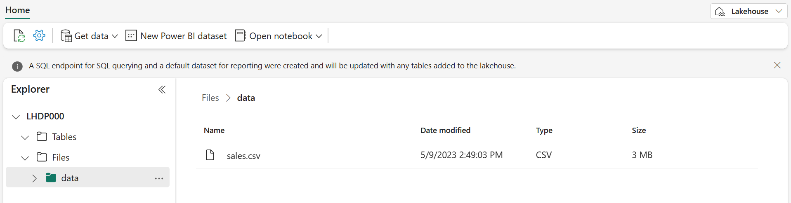
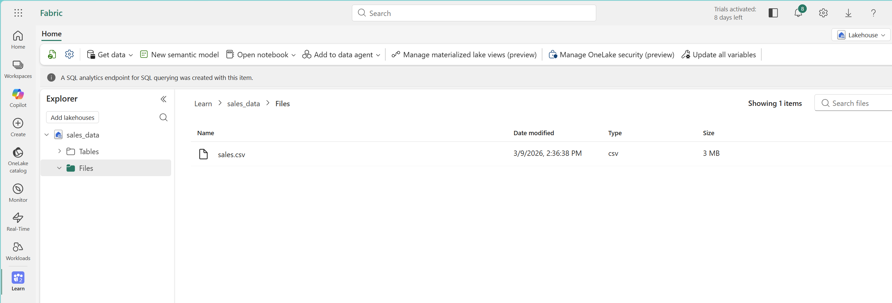
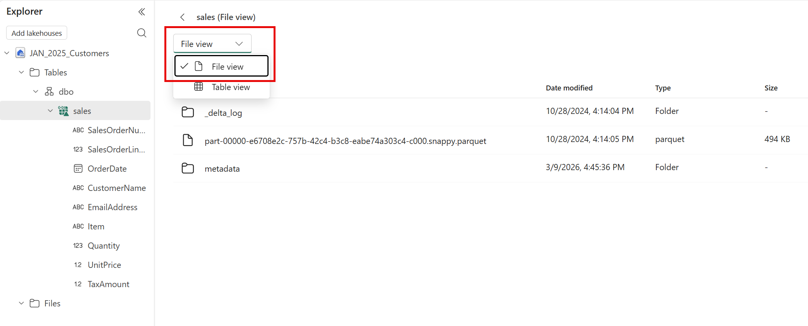
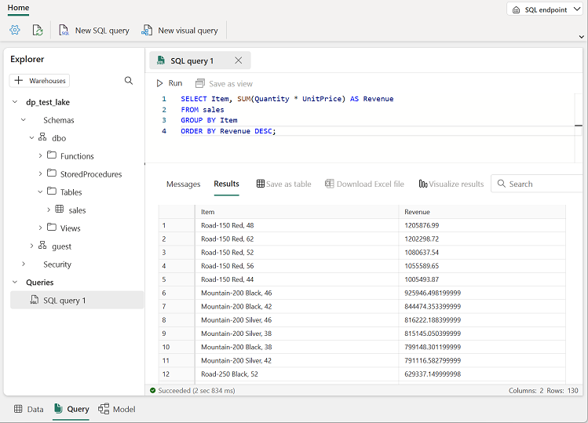
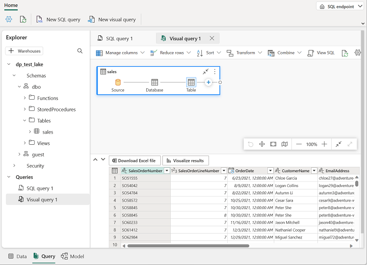
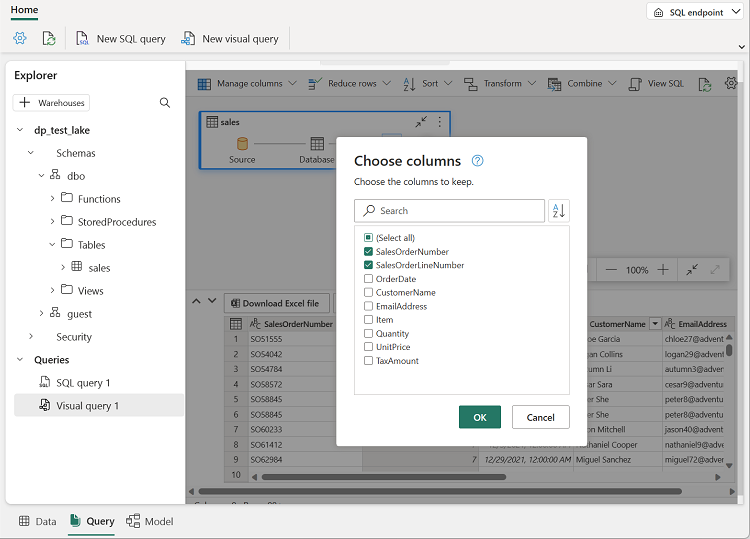
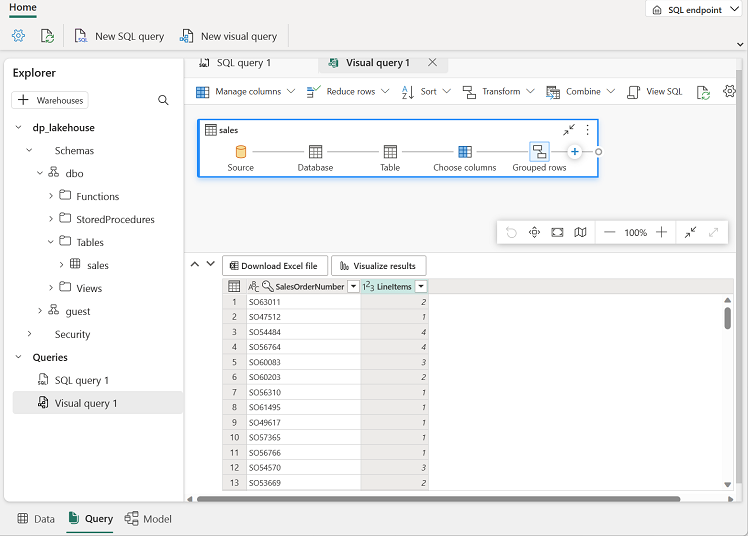

# Lab 1: Work with a Fabric Lakehouse

In this lab you load data into your lakehouse and see how it combines file storage and table storage in OneLake. You upload a CSV file, load it into a managed Delta table, and query that table with SQL and with a visual query.

**Approximate time:** 30 minutes

> **Start here:** Open your **Macula-FabricDemo-Workshop** workspace and select your **MaculaWorkshopDemo** lakehouse.

## Upload a file

Fabric gives you several ways to load data into a lakehouse, including pipelines and Dataflows Gen2 (both covered later today). One of the simplest ways to bring in a small amount of data is to upload a file from your computer.

1. In the **Explorer** pane, open the **...** menu for the **Files** folder, select **New subfolder**, and create a subfolder named `data`.
1. Open the **...** menu for the new **data** folder, select **Upload** > **Upload files**, and upload **sales.csv** from this repo (`Labs/Lab1/Assets/sales.csv`).
1. Select the **Files/data** folder and verify that **sales.csv** is listed.

    

1. Select **sales.csv** to preview its contents.

## Explore shortcuts

Sometimes the data you need is stored somewhere else. A *shortcut* lets you include externally stored data in your lakehouse without copying it, so you avoid the cost and the inconsistency risk that come with duplicated data.

1. Open the **...** menu for the **Files** folder and select **New shortcut**.
1. Look through the available data source types, then close the **New shortcut** dialog without creating a shortcut.

## Load file data into a table

Analysts and engineers can work with files directly using Apache Spark. In many cases, though, you want the data in a table so you can query it with SQL.

1. In the **Explorer** pane, select the **Files/data** folder so you can see **sales.csv**.
1. Open the **...** menu for **sales.csv** and select **Load to Tables** > **New table**.
1. In the **Load to table** dialog, set the table name to `sales`. If you are asked for the file type, select **CSV**, then confirm the load and wait for the table to be created.

    > **Tip:** If the `sales` table does not appear automatically, open the **...** menu for the **Tables** folder and select **Refresh**.

1. Select the `sales` table in the **Explorer** pane to view its data.

    

1. Open the **...** menu for the `sales` table and select **View files** to see the files behind the table.

    

    The files for a Delta table are stored in *Parquet* format. They include a subfolder named **_delta_log**, which records every transaction applied to the table.

## Use SQL to query tables

When you create a lakehouse and define tables in it, Fabric automatically creates a SQL analytics endpoint so you can query the tables with SQL `SELECT` statements.

1. At the top right of the lakehouse page, switch from **Lakehouse** to **SQL analytics endpoint**. Wait a moment for the SQL analytics endpoint to open.
1. Select **New SQL query** and enter the following query:

    ```sql
    SELECT Item, SUM(Quantity * UnitPrice) AS Revenue
    FROM sales
    GROUP BY Item
    ORDER BY Revenue DESC;
    ```

    > **Tip:** You can also copy this query from `Labs/Lab1/Assets/01-Snippets.txt`.

1. Select **&#9655; Run**. The results show total revenue for each product.

    

## Create a visual query

Analysts who know Power BI can use their Power Query skills to build a visual query instead of writing SQL.

1. On the toolbar, expand **New SQL query** and select **New visual query**.
1. Drag the `sales` table onto the new visual query canvas.

    

1. In the **Manage columns** menu, select **Choose columns**, and select only **SalesOrderNumber** and **SalesOrderLineNumber**.

    

1. In the **Transform** menu, select **Group by** and use these **Basic** settings:

    - **Group by**: SalesOrderNumber
    - **New column name**: LineItems
    - **Operation**: Count distinct values
    - **Column**: SalesOrderLineNumber

    The results pane now shows the number of line items for each sales order.

    

## What you learned

A lakehouse stores files and Delta tables together in OneLake. Managed tables can be queried with SQL straight away, through either the SQL editor or a visual query.

**Next:** [Lab 2: Ingest data with a pipeline](../Lab2/04-ingest-pipeline.md)
