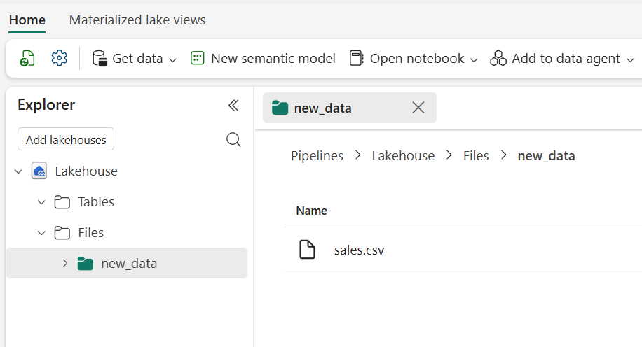
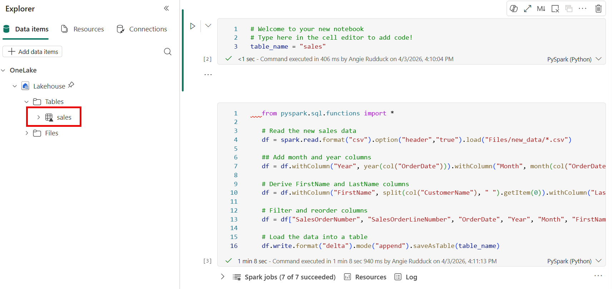
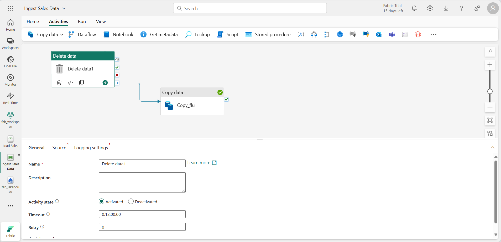
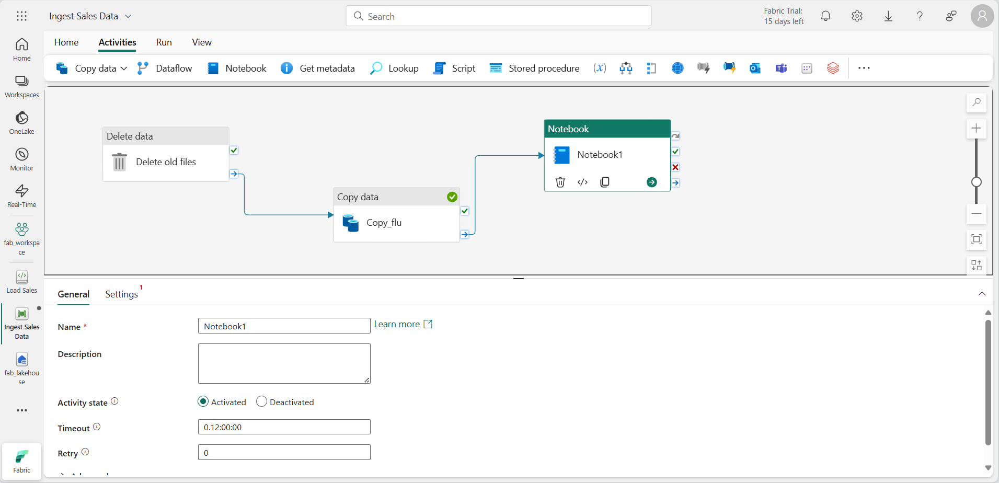
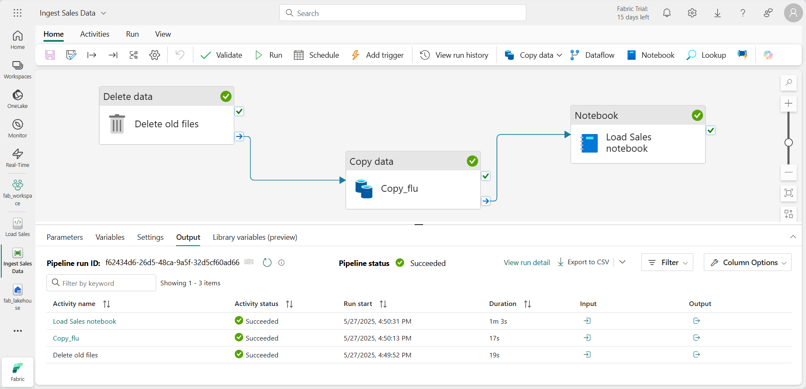

# Lab 2: Ingest data with a pipeline

In this lab you build a data pipeline that copies a file from an external source into your lakehouse, then uses a Spark notebook to transform the data and load it into a table. Together, the Copy Data activity and the notebook give you a reusable ETL process.

**Approximate time:** 45 minutes

> **Start here:** Open your **Macula-FabricDemo-Workshop** workspace and select your **MaculaWorkshopDemo** lakehouse.

## Prepare a landing folder

1. In the **Explorer** pane, open the **...** menu for the **Files** node, select **New subfolder**, and create a subfolder named `new_data`.

## Create a pipeline

A simple way to ingest data is to use a **Copy Data** activity in a pipeline. It extracts data from a source and copies it to a file in the lakehouse.

> **Note:** A *Copy Job* and a *Copy Data* activity are different ways to move data in Fabric. A Copy Job is a standalone tool and does not need a pipeline. A Copy Data activity lives inside a pipeline and can be orchestrated with other activities. In this lab you use a **Copy Data** activity.

1. In the left navigation pane, select your workspace name.
1. Select **New item**, search for **Pipeline**, and create a new pipeline named `Ingest Sales Data`.
1. In the pipeline editor, select **Copy data** > **Add copy data activity** on the toolbar. A **Copy Data** activity is added to the canvas.

### Configure the source

1. Select the **Copy Data** activity, then select the **Source** tab in the pane below the canvas.
1. In the **Connection** drop-down, select **Browse all**, then select **HTTP**. In the **Create a connection** form, enter these settings and select **Connect**:
    - **URL**: `https://raw.githubusercontent.com/MicrosoftLearning/dp-data/main/sales.csv`
    - **Connection name**: *Enter a unique name*
    - **Data gateway**: (none)
    - **Authentication kind**: Anonymous
    - **Privacy level**: None
1. Back on the **Source** tab, configure these settings:
    - **Relative URL**: *Leave blank*
    - **File format**: **DelimitedText**
1. Select the **Settings** button next to the **File format** drop-down. Confirm these settings and select **OK**:
    - **Compression type**: No compression
    - **Column delimiter**: Comma (,)
    - **Row delimiter**: Line feed (\n)
    - **First row as header**: *Selected*
1. Select **Test connection** to verify that the connection works.
1. *Optional:* Select **Preview data** to confirm the data looks correct.

### Configure the destination

1. Select the **Destination** tab. In the **Connection** drop-down, select **Browse all**.
1. In the **New connection** dialog, find your lakehouse in the *OneLake Catalog* section and select it.
1. Return to the **Destination** tab and configure these settings:
    - **Connection**: *Your new lakehouse connection*
    - **Lakehouse**: *MaculaWorkshopDemo*
    - **Root folder**: Files
    - **File path**: *Directory*: `new_data` / *File name*: `sales.csv`

    No other changes are needed.

### Run the pipeline

1. On the **Home** tab, select **Save** (&#128427;), then select **&#9655; Run**.
1. Watch the **Output** pane under the designer. Use the refresh icon (&#8635;) until the status shows **Succeeded**.
1. In the left navigation pane, select your lakehouse. In the **Explorer** pane, expand **Files**, select **new_data**, and verify that **sales.csv** was copied.

    

## Create a notebook

1. Go to your workspace, select **+ New item**, search for **Notebook**, and create a new notebook. It opens with a single *cell*. Notebooks are made of cells that hold *code* or *markdown* (formatted text).
1. In the **Explorer** pane, select **Add data items** > **OneLake catalog** and add your **MaculaWorkshopDemo** lakehouse.
1. Replace the code in the existing cell with this variable declaration:

    ```python
    table_name = "dbo.sales_clean"
    ```

    > **Why not `dbo.sales`?** You already created a `sales` table in Lab 1. This notebook creates a table with different columns, so it uses a new name to avoid a schema conflict.

1. Open the **...** menu at the top right of the cell and select **Toggle parameter cell**. The variables in this cell are now treated as parameters when the notebook runs from a pipeline.
1. Select **+ Code** to add a new cell below the parameter cell, and add this code:

    ```python
    from pyspark.sql.functions import *

    # Read the new sales data
    df = spark.read.format("csv").option("header","true").load("Files/new_data/*.csv")

    ## Add month and year columns
    df = df.withColumn("Year", year(col("OrderDate"))).withColumn("Month", month(col("OrderDate")))

    # Derive FirstName and LastName columns
    df = df.withColumn("FirstName", split(col("CustomerName"), " ").getItem(0)).withColumn("LastName", split(col("CustomerName"), " ").getItem(1))

    # Filter and reorder columns
    df = df["SalesOrderNumber", "SalesOrderLineNumber", "OrderDate", "Year", "Month", "FirstName", "LastName", "EmailAddress", "Item", "Quantity", "UnitPrice", "TaxAmount"]

    # Load the data into a table
    df.write.format("delta").mode("append").saveAsTable(table_name)
    ```

    This code reads the file that the **Copy Data** activity ingested, applies some transformations, and saves the result as a table. If the table already exists, the new rows are appended.

1. Select **&#9655; Run all** on the toolbar.

    > **Note:** This is the first Spark code you run in this session, so the Spark pool has to start. The first cell can take a minute or so.

1. When the run completes, open the **...** menu for **Tables** in the **Explorer** pane, select **Refresh**, and verify that a **sales_clean** table exists.
1. Select the **Settings** icon in the notebook menu bar, set the notebook **Name** to `Load Sales`, and close the settings pane.
1. Select your lakehouse in the left hub bar, refresh the **Explorer** pane, expand **Tables**, and select **sales_clean** to preview the data.

    

## Modify the pipeline

Now you add the notebook to the pipeline to create a reusable ETL process.

1. In the left hub bar, select the **Ingest Sales Data** pipeline.
1. On the **Activities** tab, select **Delete data** from the **All activities** list. Place the new **Delete data** activity to the left of the **Copy data** activity, and connect its **On completion** output to the **Copy data** activity.

    

1. Select the **Delete data** activity and set these properties in the pane below the canvas:
    - **General**
        - **Name**: `Delete old files`
    - **Source**
        - **Connection**: Browse all, and select your lakehouse
        - **File path type**: Wildcard file path
        - **Folder path**: Files / **new_data**
        - **Wildcard file name**: `*.csv`
        - **Recursively**: *Selected*
    - **Logging settings**
        - **Enable logging**: *<u>Un</u>selected*

    These settings delete any existing .csv files before **sales.csv** is copied again.

1. On the **Activities** tab, select **Notebook** to add a **Notebook** activity.
1. Select the **Copy data** activity and connect its **On Completion** output to the **Notebook** activity.

    

1. Select the **Notebook** activity and set these properties:
    - **General**
        - **Name**: `Load Sales notebook`
    - **Settings**
        - **Notebook**: Select your **Load Sales** notebook
        - **Base parameters**: *Add a new parameter with these values:*

            | Name | Type | Value |
            | -- | -- | -- |
            | table_name | String | dbo.new_sales |

    The **table_name** parameter is passed to the notebook and overrides the default value in the parameters cell.

1. On the **Home** tab, select **Save** (&#128427;), then select **&#9655; Run**. Wait for all activities to complete.

    

    > **Troubleshooting:** If you see the error *Spark SQL queries are only possible in the context of a lakehouse. Please attach a lakehouse to proceed*, open your notebook, select the lakehouse in the left pane, select **Remove all Lakehouses**, and add it again. Then go back to the pipeline and select **&#9655; Run**.

1. Select your lakehouse in the left hub bar. In the **Explorer** pane, expand **Tables** and select **new_sales** to preview the data. The notebook created this table when the pipeline ran it.

## What you learned

A pipeline can copy data from an external source into OneLake, then call a Spark notebook to transform it and load it into a table. Parameters let the same notebook run for different target tables.

**Next:** [Lab 3: Create and use Dataflows (Gen2)](../Lab3/05-dataflows-gen2.md)
