# Lab 3: Create and use Dataflows (Gen2)

In this lab you create a Dataflow Gen2 that pulls data from a CSV file, transforms it in Power Query Online, and loads it into your lakehouse. You then run the dataflow from a data pipeline, which is how you orchestrate dataflows in practice.

This lab introduces the main elements of Dataflows Gen2. It is not meant to build a complex enterprise solution.

**Approximate time:** 30 minutes

> **Start here:** Open your **Macula-FabricDemo-Workshop** workspace and select your **MaculaWorkshopDemo** lakehouse.

## Create a Dataflow Gen2 to ingest data

A dataflow wraps an *extract, transform, and load* (ETL) process in a single item you can reuse and schedule.

1. On the home page of your lakehouse, select **Get data** > **New Dataflow Gen2**. After a few seconds, the Power Query editor opens.

    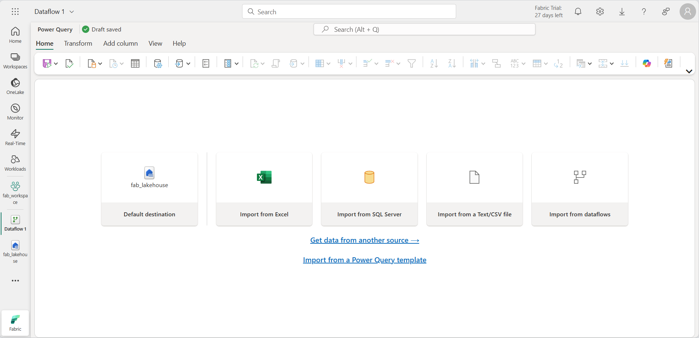

1. Select **Import from a Text/CSV file** and create a new data source with these settings:
    - **Link to file**: *Selected*
    - **File path or URL**: `https://raw.githubusercontent.com/MicrosoftLearning/dp-data/main/orders.csv`
    - **Connection**: Create new connection
    - **Connection name**: *Enter a unique name*
    - **Data gateway**: (none)
    - **Authentication kind**: Anonymous
1. Select **Next** to preview the file data, then select **Create**. The Power Query editor shows the data source and an initial set of query steps.

    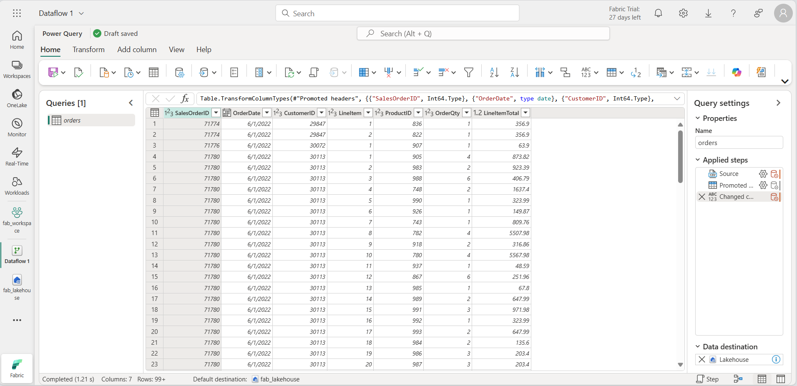

1. On the toolbar ribbon, select the **Add column** tab, then select **Custom column**.
1. Set **New column name** to `MonthNo`, set **Data type** to **Whole Number**, and enter this formula: `Date.Month([OrderDate])`

    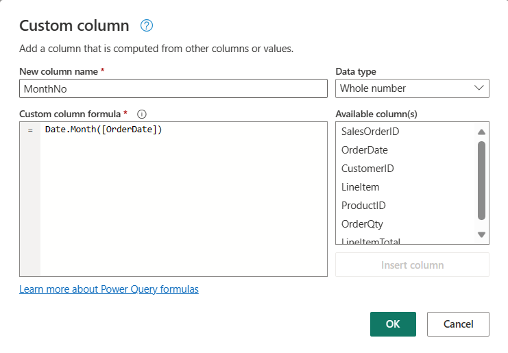

1. Select **OK**. A step for the custom column is added to the query, and the new column appears in the data pane.

    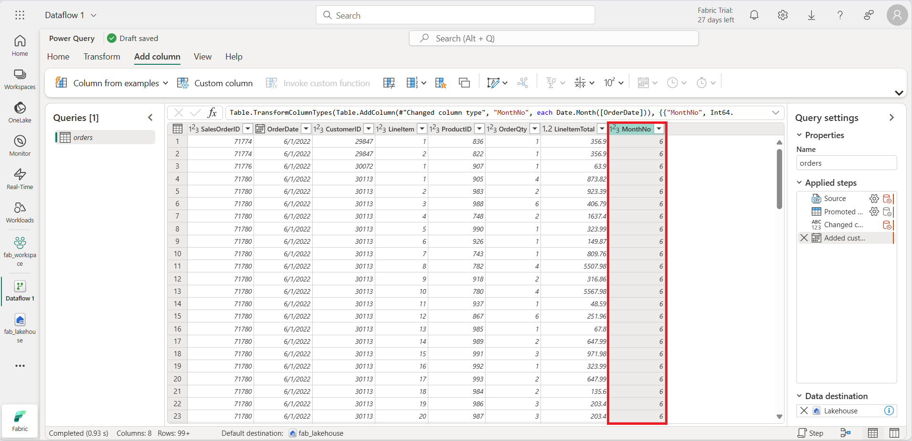

    > **Tip:** In the **Query Settings** pane on the right, the **Applied Steps** list shows every transformation. At the bottom you can turn on **Diagram flow** to see the steps visually. You can move steps up or down, edit them with the gear icon, and select any step to see its effect in the preview.

1. Confirm that the **OrderDate** column has the **Date** data type and the new **MonthNo** column has the **Whole Number** data type.

## Add a data destination for the dataflow

1. On the **Home** tab of the ribbon, in the **Query** section, select **Add data destination**.

    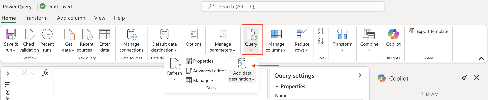

    > **Note:** If **Add data destination** is grayed out, or a lakehouse destination is already shown on the query, your lakehouse was attached automatically as the default destination because you started the dataflow from inside the lakehouse. Select the existing lakehouse destination icon on the query to open its settings, then continue from step 5 below.

1. Select **Lakehouse**.
1. In the **Connect to default data destination** dialog, edit the connection and sign in with your Power BI organizational account. This sets the identity the dataflow uses to access the lakehouse.

    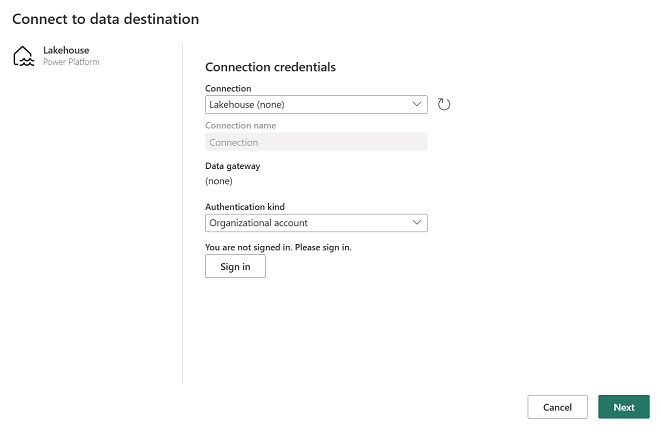

1. Select **Next**, find your workspace, and select the **MaculaWorkshopDemo** lakehouse. Then specify a new table named `orders`.

    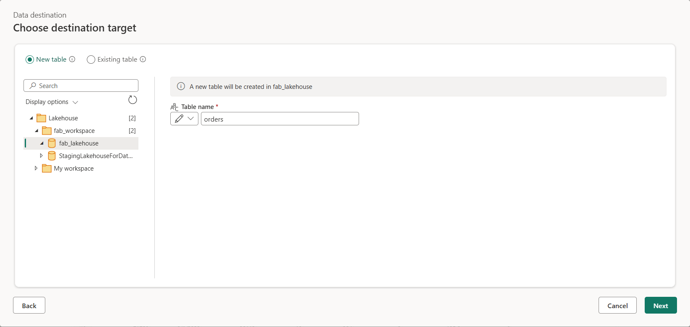

1. Select **Next**. On the **Choose destination settings** page, turn off **Use automatic settings**, select **Append**, and then select **Save settings**.

    > **Note:** The Power Query editor is the recommended place to change data types, but you can also do it from this page.

    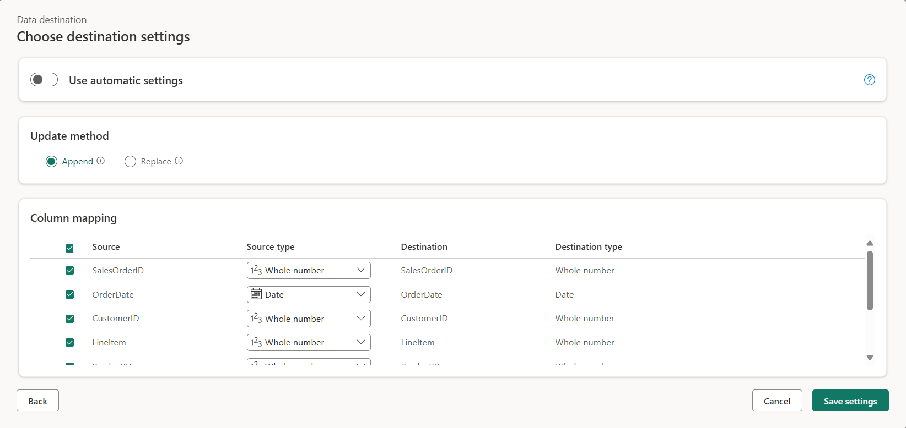

1. On the menu bar, open **View** and select **Diagram view**. The lakehouse destination now appears as an icon on the query.

    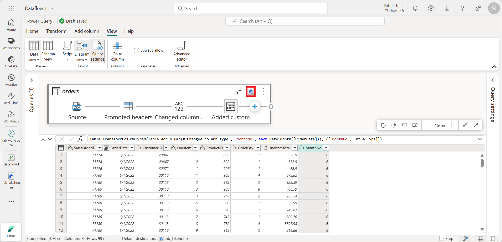

1. On the **Home** tab, select **Save & run**, and wait for **Dataflow 1** to be created in your workspace.

## Add the dataflow to a pipeline

You can include a dataflow as an activity in a pipeline. Pipelines orchestrate ingestion and processing, so you can combine dataflows with other operations in one scheduled process.

1. In your workspace, select **+ New item** > **Data pipeline**, and create a new pipeline named `Load data`. The pipeline editor opens.

    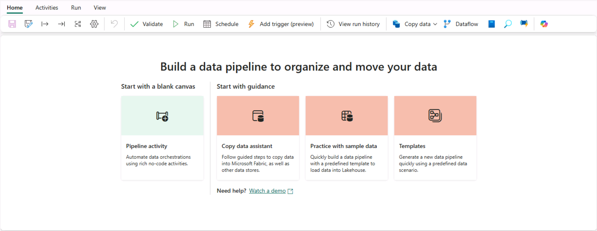

    > **Tip:** If the Copy Data wizard opens automatically, close it.

1. Select **Pipeline activity** and add a **Dataflow** activity.
1. With the new **Dataflow1** activity selected, open the **Settings** tab and choose **Dataflow 1** (the dataflow you just created) in the **Dataflow** drop-down.

    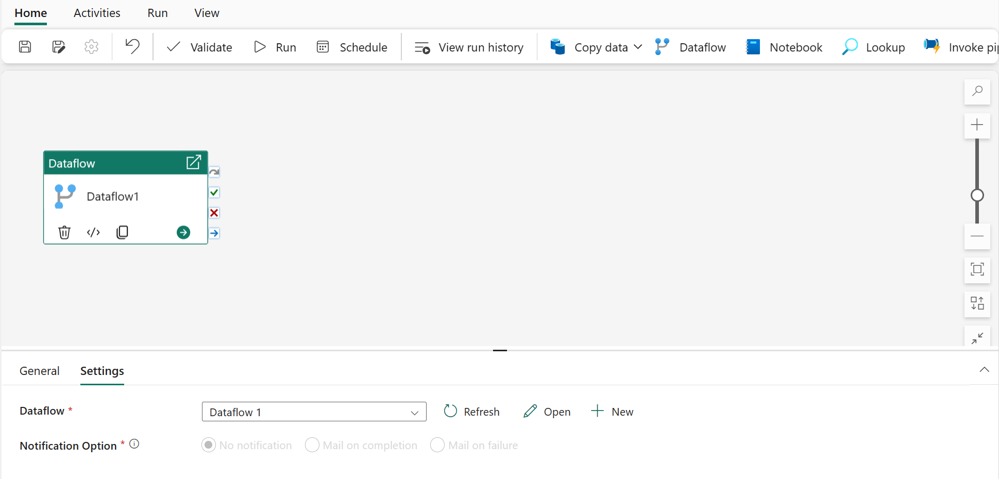

1. On the **Home** tab, select **Save** (&#128427;).
1. Select **&#9655; Run** and wait for the pipeline to finish. This can take a few minutes.

    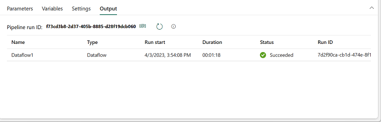

1. Select your lakehouse in the left menu bar.
1. Open the **...** menu for **Tables** and select **Refresh**. Expand **Tables** and select the **orders** table that your dataflow created.

    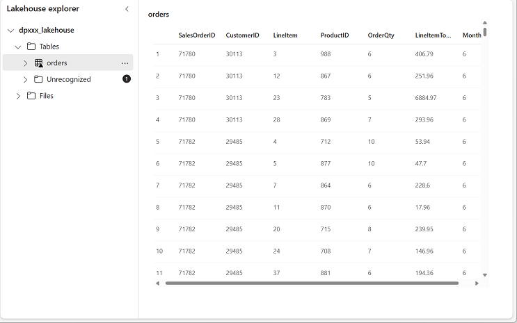

> **Tip:** In Power BI Desktop, you can connect directly to the output of your dataflow using the *Power BI dataflows (Legacy)* connector. You can also make further transformations and publish the result as a new semantic model for a specific audience.
>
> 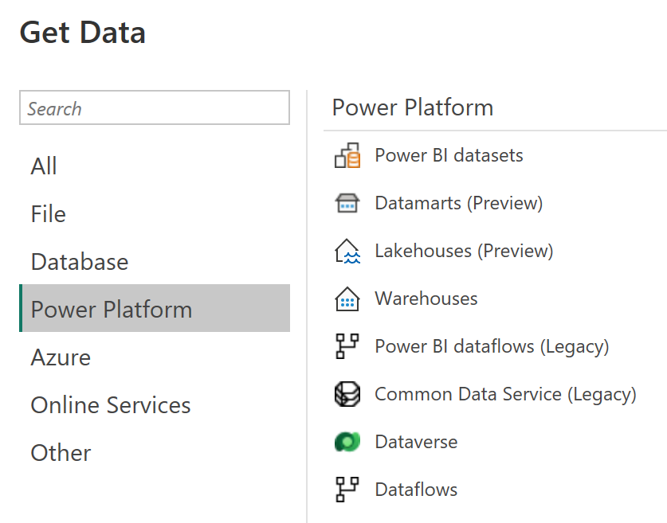

## What you learned

A Dataflow Gen2 gives you a low-code way to shape data with Power Query and load it to a lakehouse. Running it from a pipeline lets you schedule it and combine it with other activities.

**Next:** [Lab 4: Analyze data with Apache Spark](../Lab4/02-analyze-spark.md)
