# Lab 4: Analyze data with Apache Spark

In this lab you upload a folder of CSV files to your lakehouse and use PySpark in a Fabric notebook to read, explore, transform, and visualize the data. You also save the results as Parquet files and as a Delta table you can query with SQL.

**Approximate time:** 45 minutes

> **Start here:** Open your **Macula-FabricDemo-Workshop** workspace and select your **MaculaWorkshopDemo** lakehouse.

## Upload the data files

1. In the **Explorer** pane, open the **...** menu next to the **Files** folder and select **Upload** > **Upload folder**.
1. Browse to this repo on your computer, select the `Labs/Lab4/Assets/orders` folder (it contains **2019.csv**, **2020.csv**, and **2021.csv**), and select **Upload**.
1. Expand **Files**, select the **orders** folder, and check that the three CSV files were uploaded.

    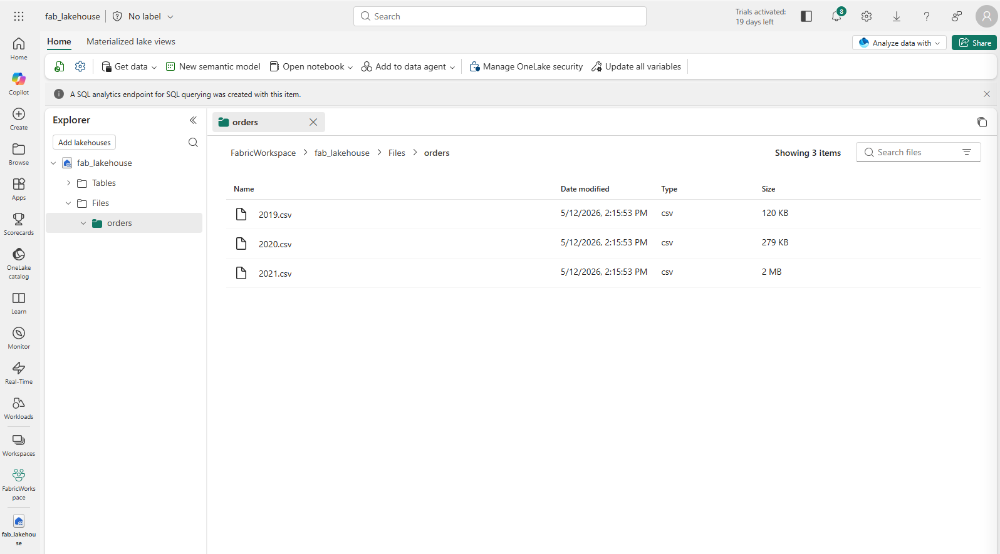

## Create a notebook

Notebooks give you an interactive place to write and run code.

1. In the lakehouse, select **Open notebook** > **New notebook**. A notebook named **Notebook 1** opens.

    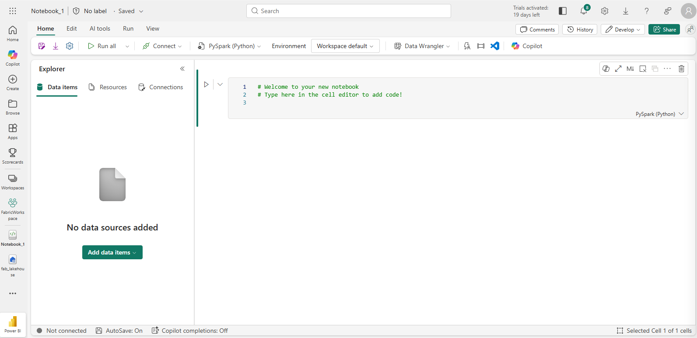

1. Select the name panel above the **Home** tab and rename the notebook to something descriptive, such as `Sales Order Exploration`.
1. Select the first cell (a code cell) and use the **M↓** button in the top-right toolbar to convert it to a markdown cell.
1. Select the pencil button to edit the cell, and replace its contents with:

    ```markdown
    # Sales order data exploration
    Use this notebook to explore sales order data
    ```

    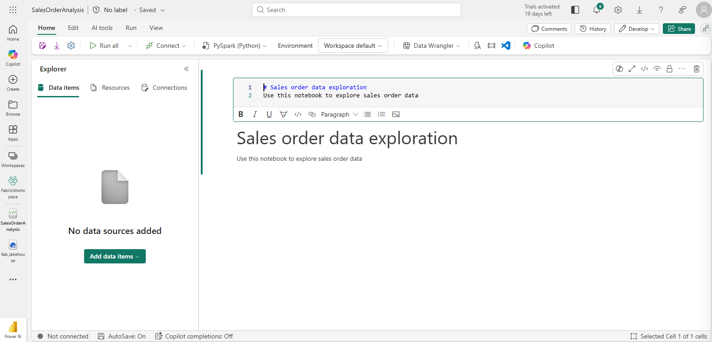

1. Select anywhere outside the cell to stop editing.

## Create a DataFrame

You will use PySpark, the default language for Fabric notebooks. It is the version of Python optimized for Spark.

> **Note:** Fabric notebooks also support Scala, R, and Spark SQL.

1. In the **Explorer** pane, expand **Files** and select the **orders** folder. The CSV files are listed next to the notebook editor.

    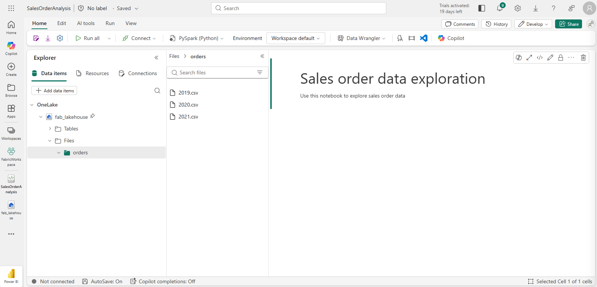

1. Open the **...** menu for **2019.csv** and select **Load data** > **Spark**. This code is generated in a new cell:

    ```python
    df = spark.read.format("csv").option("header","true").load("Files/orders/2019.csv")
    # df now is a Spark DataFrame containing CSV data from "Files/orders/2019.csv".
    display(df.limit(100))
    ```

    > **Tip:** Use the « icons to hide the Explorer pane and give the notebook more room.

1. Select **&#9655; Run cell** to the left of the cell.

    > **Note:** The first time you run Spark code, a Spark session starts. This can take a few seconds or longer. Later runs in the same session are faster.

1. Review the output below the cell.

    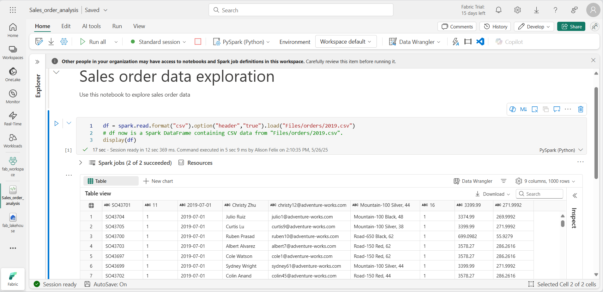

1. The column headers contain the first line of data. To correct this, change the first line of the existing code to:

    ```python
    df = spark.read.format("csv").option("header","false").load("Files/orders/2019.csv")
    ```

1. Run the cell again. The first row is now treated as data, and the column names become `_c0`, `_c1`, and so on.
1. To get meaningful column names, define a schema. Replace the existing code with:

    ```python
    from pyspark.sql.types import *

    orderSchema = StructType([
        StructField("SalesOrderNumber", StringType()),
        StructField("SalesOrderLineNumber", IntegerType()),
        StructField("OrderDate", DateType()),
        StructField("CustomerName", StringType()),
        StructField("Email", StringType()),
        StructField("Item", StringType()),
        StructField("Quantity", IntegerType()),
        StructField("UnitPrice", FloatType()),
        StructField("Tax", FloatType())
    ])

    df = spark.read.format("csv").schema(orderSchema).load("Files/orders/2019.csv")

    display(df)
    ```

1. Run the cell and review the output.

    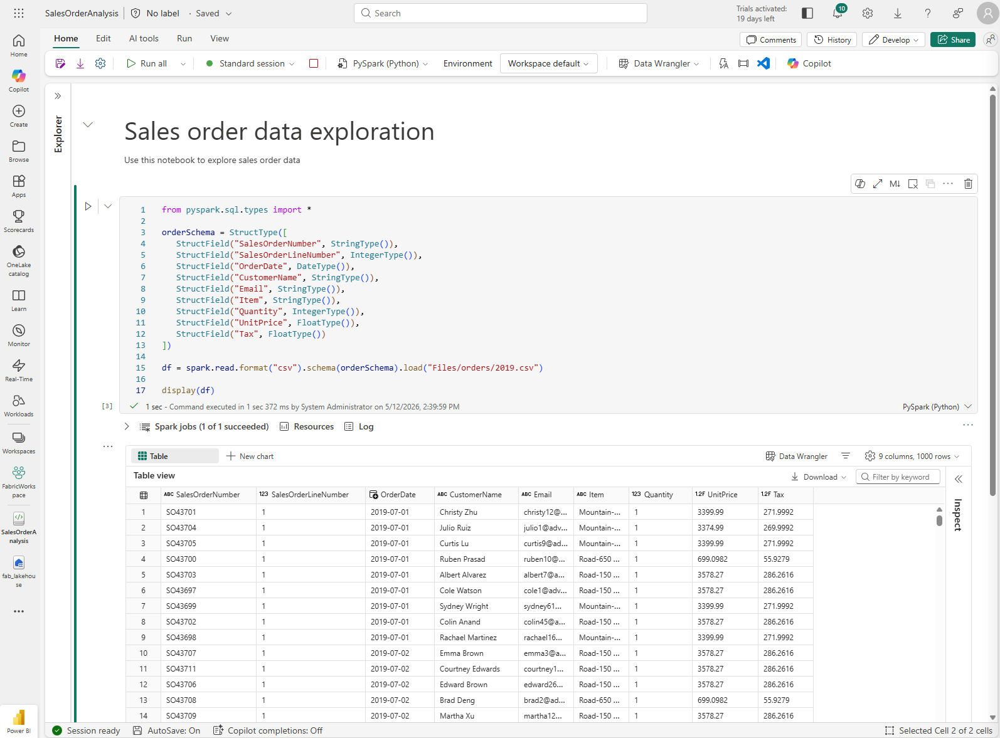

1. This DataFrame holds only 2019 data. Change the file path to use a `*` wildcard so it reads every file in the folder:

    ```python
    from pyspark.sql.types import *

    orderSchema = StructType([
        StructField("SalesOrderNumber", StringType()),
        StructField("SalesOrderLineNumber", IntegerType()),
        StructField("OrderDate", DateType()),
        StructField("CustomerName", StringType()),
        StructField("Email", StringType()),
        StructField("Item", StringType()),
        StructField("Quantity", IntegerType()),
        StructField("UnitPrice", FloatType()),
        StructField("Tax", FloatType())
    ])

    df = spark.read.format("csv").schema(orderSchema).load("Files/orders/*.csv")

    display(df)
    ```

1. Run the modified code. You should see sales for 2019, 2020, and 2021. Only a subset of rows is shown, so you may not see every year.

    > **Note:** Select **...** next to a result to hide or show a cell's output.

## Explore data in a DataFrame

A DataFrame lets you filter, group, and manipulate data.

### Filter a DataFrame

1. Add a code cell by selecting **+ Code** (it appears when you hover above or below a cell). You can also use **Edit** > **+ Add code cell below** on the ribbon.
1. Enter this code. It returns two columns and uses `count` and `distinct` to summarize the records:

    ```python
    customers = df['CustomerName', 'Email']

    print(customers.count())
    print(customers.distinct().count())

    display(customers.distinct())
    ```

1. Run the code and examine the output:

    * The code creates a new DataFrame named **customers** with a subset of the columns in **df**. A DataFrame transformation never changes the original DataFrame. It returns a new one.
    * You can get the same result with the `select` method:

    ```python
    customers = df.select("CustomerName", "Email")
    ```

    * `count` and `distinct` give you the total number of customers and the number of unique customers.

1. Change the first line to use `select` with a `where` function:

    ```python
    customers = df.select("CustomerName", "Email").where(df['Item']=='Road-250 Red, 52')
    print(customers.count())
    print(customers.distinct().count())

    display(customers.distinct())
    ```

1. Run it. The result shows only customers who bought the Road-250 Red, 52 product. You can chain functions so the output of one becomes the input of the next. Here, the DataFrame from `select` is the source for `where`.

### Aggregate and group data in a DataFrame

1. Add a code cell and enter:

    ```python
    productSales = df.select("Item", "Quantity").groupBy("Item").sum()

    display(productSales)
    ```

1. Run it. The results show the sum of order quantities by product. `groupBy` groups rows by Item, and `sum` is applied to the remaining numeric column, Quantity.
1. Add another code cell and enter:

    ```python
    from pyspark.sql.functions import *

    yearlySales = df.select(year(col("OrderDate")).alias("Year")).groupBy("Year").count().orderBy("Year")

    display(yearlySales)
    ```

1. Run it and examine the output, which shows the number of sales orders per year:

    * `import` makes the Spark SQL functions available.
    * `select` with the SQL `year` function extracts the year from **OrderDate**.
    * `alias` names the extracted value **Year**.
    * `groupBy` groups the data by the derived Year column.
    * `count` calculates the rows in each group, and `orderBy` sorts the result.

    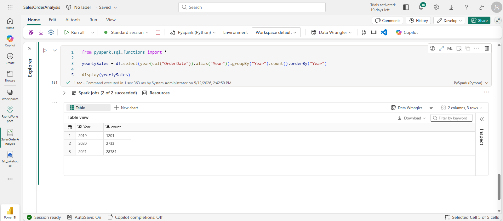

## Use Spark to transform data files

Transforming data for downstream processing is a core task for data engineers and data scientists.

### Use DataFrame methods and functions to transform data

1. Add a code cell and enter:

    ```python
    from pyspark.sql.functions import *

    # Create Year and Month columns
    transformed_df = df.withColumn("Year", year(col("OrderDate"))).withColumn("Month", month(col("OrderDate")))

    # Create the new FirstName and LastName fields
    transformed_df = transformed_df.withColumn("FirstName", split(col("CustomerName"), " ").getItem(0)).withColumn("LastName", split(col("CustomerName"), " ").getItem(1))

    # Filter and reorder columns
    transformed_df = transformed_df["SalesOrderNumber", "SalesOrderLineNumber", "OrderDate", "Year", "Month", "FirstName", "LastName", "Email", "Item", "Quantity", "UnitPrice", "Tax"]

    # Display the first five orders
    display(transformed_df.limit(5))
    ```

1. Run the cell. The new DataFrame has:

    * Year and Month columns based on **OrderDate**.
    * FirstName and LastName columns based on **CustomerName**.
    * Filtered and reordered columns, with **CustomerName** removed.

1. Review the output and confirm the transformations.

> **Tip:** See the [Apache Spark DataFrame](https://spark.apache.org/docs/latest/api/python/reference/pyspark.sql/dataframe.html) documentation to learn more.

### Save the transformed data

*Parquet* is a popular storage format because it stores data efficiently and most large-scale analytics systems support it. A common transformation task is converting data from a format such as CSV to Parquet.

1. Add a code cell and enter:

    ```python
    transformed_df.write.mode("overwrite").parquet('Files/transformed_data/orders')

    print ("Transformed data saved!")
    ```

1. Run it and wait for the message. In the **Explorer** pane, open the **...** menu for **Files** and select **Refresh**. Select **transformed_data** and verify that it contains a folder named **orders** with one or more Parquet files.
1. Add a cell with this code:

    ```python
    orders_df = spark.read.format("parquet").load("Files/transformed_data/orders")
    display(orders_df)
    ```

1. Run it. A new DataFrame is created from the Parquet files, and the results show the order data.

    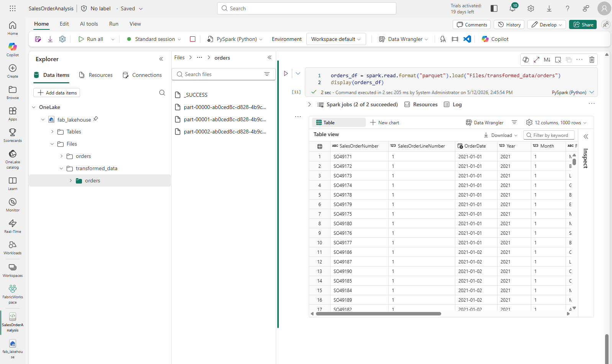

### Save data in partitioned files

With large volumes of data, partitioning improves performance and makes filtering easier.

1. Add a cell with code that saves the DataFrame partitioned by Year and Month:

    ```python
    orders_df.write.partitionBy("Year","Month").mode("overwrite").parquet("Files/partitioned_data")

    print ("Transformed data saved!")
    ```

1. Run it and wait for the message. Refresh **Files** in the **Explorer** pane and expand **partitioned_data**. You should see folders named *Year=xxxx*, each containing folders named *Month=xxxx*, and each month folder holds a Parquet file with that month's orders.

    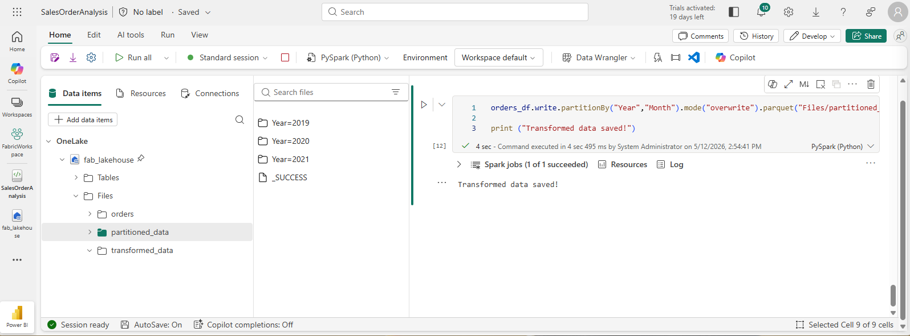

1. Add a new cell that loads a DataFrame from the partitioned files:

    ```python
    orders_2021_df = spark.read.format("parquet").load("Files/partitioned_data/Year=2021/Month=*")

    display(orders_2021_df)
    ```

1. Run it and verify that the results show 2021 sales. The partitioning columns in the path (Year and Month) are not included in the DataFrame.

## Work with tables and SQL

The DataFrame methods let you query and analyze file data directly. If you prefer SQL, Fabric lakehouses support Delta tables stored in OneLake that you can query with Spark SQL. This gives you the flexibility of a data lake with the schema and SQL queries of a data warehouse, which is why it is called a *lakehouse*.

### Create a table

1. Add a code cell and enter this code, which saves the sales order DataFrame as a table named *salesorders*:

    ```python
    # Create a new table
    df.write.format("delta").saveAsTable("salesorders")

    # Get the table description
    spark.sql("DESCRIBE EXTENDED salesorders").show(truncate=False)
    ```

    > **Note:** The table is saved in Delta format, which adds transactions, row versioning, and other database-style features. Its files live in the lakehouse **Tables** folder in OneLake and are managed by Fabric.

1. Run the cell and review the output, which describes the new table.
1. In the **Explorer** pane, open the **...** menu for the **Tables** folder and select **Refresh**. Expand **Tables** and verify that **salesorders** exists.

    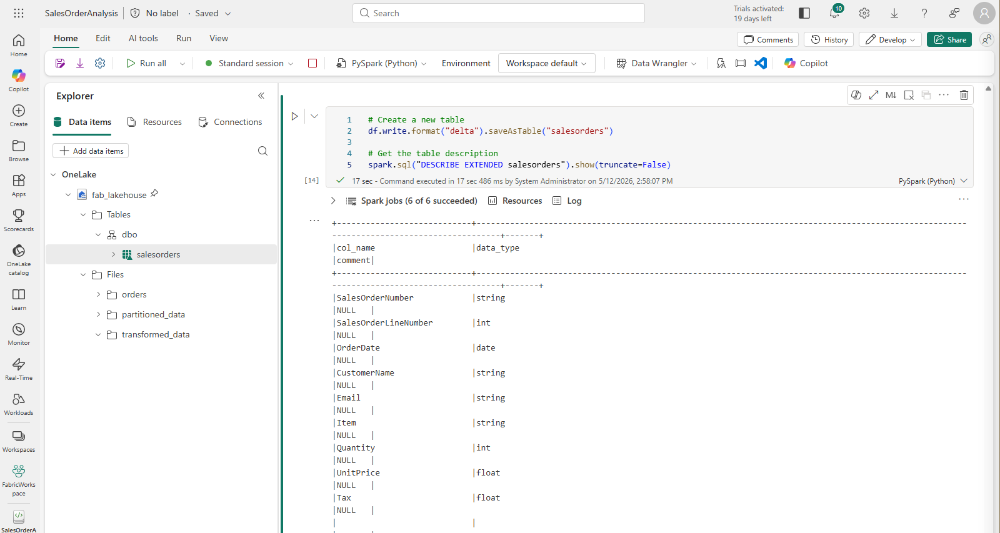

1. Open the **...** menu for **salesorders** and select **Load data** > **Spark**. A new cell is added with code similar to this:

    ```python
    df = spark.sql("SELECT * FROM [your_lakehouse].dbo.salesorders LIMIT 1000")

    display(df)
    ```

1. Run it. This embeds a SQL query in PySpark code and loads the results into a DataFrame.

### Run SQL code in a cell

Analysts often want to work directly in SQL.

1. Add a new code cell and enter:

    ```sql
    %%sql
    SELECT YEAR(OrderDate) AS OrderYear,
           SUM((UnitPrice * Quantity) + Tax) AS GrossRevenue
    FROM salesorders
    GROUP BY YEAR(OrderDate)
    ORDER BY OrderYear;
    ```

1. Run it and review the results:

    * The `%%sql` command at the top (called a magic) switches the cell language to Spark SQL.
    * The SQL references the *salesorders* table you created.
    * The query output appears automatically under the cell.

> **Note:** See the [Apache Spark SQL](https://spark.apache.org/sql/) documentation for more.

## Visualize data with Spark

Charts show patterns and trends faster than scanning thousands of rows. Fabric notebooks include a built-in chart view, but it is not designed for complex charts. For more control, use Python graphics libraries such as *matplotlib* or *seaborn*.

### View results as a chart

1. Add a new code cell and enter:

    ```sql
    %%sql
    SELECT * FROM salesorders
    ```

1. Run it. In the results section beneath the cell, select **+ New chart**.
1. Select **Build my own** at the bottom right of the results section and use these settings:

    * Chart type: Bar chart
    * X-axis: Item
    * Y-axis: Quantity
    * Series Group: --None--
    * Aggregation: Sum
    * Missing and NULL values: Display as 0
    * Stacked: Unselected

1. Your chart should look similar to this:

    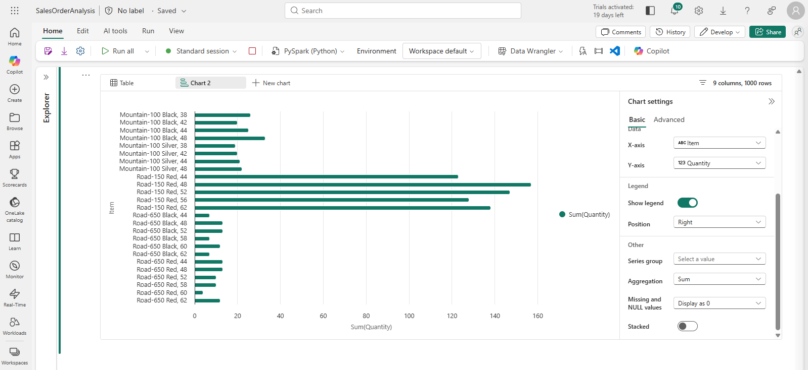

### Get started with matplotlib

1. Add a new code cell and enter:

    ```python
    sqlQuery = "SELECT CAST(YEAR(OrderDate) AS CHAR(4)) AS OrderYear, \
                    SUM((UnitPrice * Quantity) + Tax) AS GrossRevenue, \
                    COUNT(DISTINCT SalesOrderNumber) AS YearlyCounts \
                FROM salesorders \
                GROUP BY CAST(YEAR(OrderDate) AS CHAR(4)) \
                ORDER BY OrderYear"
    df_spark = spark.sql(sqlQuery)
    df_spark.show()
    ```

1. Run it. It returns a Spark DataFrame with yearly revenue and number of orders. To chart it, you first use matplotlib, the core plotting library that many others build on.
1. Add a new code cell and enter:

    ```python
    from matplotlib import pyplot as plt

    # matplotlib requires a Pandas dataframe, not a Spark one
    df_sales = df_spark.toPandas()

    # Create a bar plot of revenue by year
    plt.bar(x=df_sales['OrderYear'], height=df_sales['GrossRevenue'])

    # Display the plot
    plt.show()
    ```

1. Run it. The result is a column chart of total gross revenue by year. Note the following in the code:

    * matplotlib needs a Pandas DataFrame, so the Spark DataFrame is converted first.
    * The *pyplot* object is the foundation of most plotting functionality.
    * The default settings give a usable chart, and there is a lot of room to customize it.

1. Change the code to customize the chart:

    ```python
    from matplotlib import pyplot as plt

    # Clear the plot area
    plt.clf()

    # Create a bar plot of revenue by year
    plt.bar(x=df_sales['OrderYear'], height=df_sales['GrossRevenue'], color='orange')

    # Customize the chart
    plt.title('Revenue by Year')
    plt.xlabel('Year')
    plt.ylabel('Revenue')
    plt.grid(color='#95a5a6', linestyle='--', linewidth=2, axis='y', alpha=0.7)
    plt.xticks(rotation=45)

    # Show the figure
    plt.show()
    ```

1. Run the cell again. The chart is easier to read.
1. A plot sits inside a Figure. So far the figure was created implicitly, but you can create it explicitly:

    ```python
    from matplotlib import pyplot as plt

    # Clear the plot area
    plt.clf()

    # Create a Figure
    fig = plt.figure(figsize=(8,3))

    # Create a bar plot of revenue by year
    plt.bar(x=df_sales['OrderYear'], height=df_sales['GrossRevenue'], color='orange')

    # Customize the chart
    plt.title('Revenue by Year')
    plt.xlabel('Year')
    plt.ylabel('Revenue')
    plt.grid(color='#95a5a6', linestyle='--', linewidth=2, axis='y', alpha=0.7)
    plt.xticks(rotation=45)

    # Show the figure
    plt.show()
    ```

1. Run it again. The figure sets the shape and size of the plot.
1. A figure can hold several subplots, each on its own axis:

    ```python
    from matplotlib import pyplot as plt

    # Clear the plot area
    plt.clf()

    # Create a figure for 2 subplots (1 row, 2 columns)
    fig, ax = plt.subplots(1, 2, figsize = (10,4))

    # Create a bar plot of revenue by year on the first axis
    ax[0].bar(x=df_sales['OrderYear'], height=df_sales['GrossRevenue'], color='orange')
    ax[0].set_title('Revenue by Year')

    # Create a pie chart of yearly order counts on the second axis
    ax[1].pie(df_sales['YearlyCounts'])
    ax[1].set_title('Orders per Year')
    ax[1].legend(df_sales['OrderYear'])

    # Add a title to the Figure
    fig.suptitle('Sales Data')

    # Show the figure
    plt.show()
    ```

1. Run it again and view the result.

> **Note:** See the [matplotlib](https://matplotlib.org/) documentation to learn more.

### Use the seaborn library

*matplotlib* can need complex code to get the best results, so other libraries build on it to hide that complexity. One of them is seaborn.

1. Add a new code cell and enter:

    ```python
    import seaborn as sns
    import warnings

    # Clear the plot area
    plt.clf()

    # Suppress FutureWarning from seaborn
    warnings.filterwarnings('ignore', message='use_inf_as_na', category=FutureWarning)

    # Create a bar chart
    ax = sns.barplot(x="OrderYear", y="GrossRevenue", data=df_sales)

    plt.show()
    ```

1. Run it to see a bar chart made with seaborn.
1. Change the code to set a visual theme:

    ```python
    import seaborn as sns

    # Clear the plot area
    plt.clf()

    # Set the visual theme for seaborn
    sns.set_theme(style="whitegrid")

    # Create a bar chart
    ax = sns.barplot(x="OrderYear", y="GrossRevenue", data=df_sales)

    plt.show()
    ```

1. Run it. Seaborn lets you set a color theme for your plots.
1. Change the code again to draw a line chart:

    ```python
    import seaborn as sns

    # Clear the plot area
    plt.clf()

    # Create a line chart
    ax = sns.lineplot(x="OrderYear", y="GrossRevenue", data=df_sales)

    plt.show()
    ```

1. Run it to see yearly revenue as a line chart.

> **Note:** See the [seaborn](https://seaborn.pydata.org/index.html) documentation to learn more.

## What you learned

You used PySpark to load, explore, transform, and save data in OneLake, then used Spark SQL and Python charting libraries on the same data.

**Next:** [Lab 5: Use Delta tables in Apache Spark](../Lab5/03-delta-lake.md)
