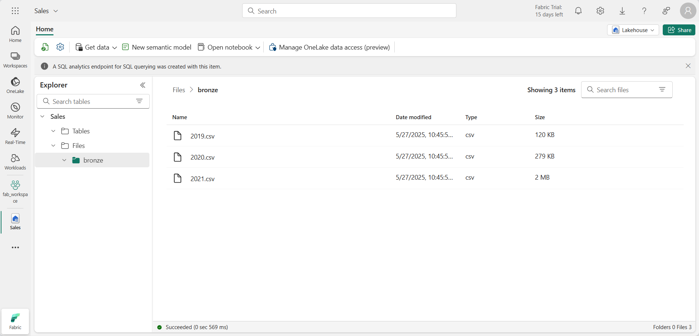
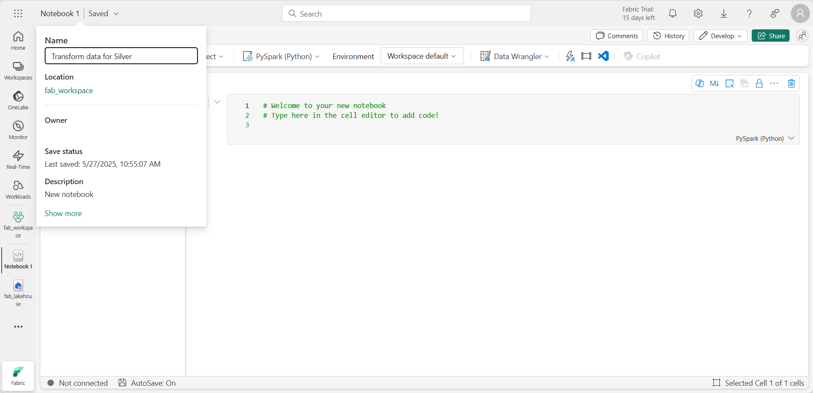
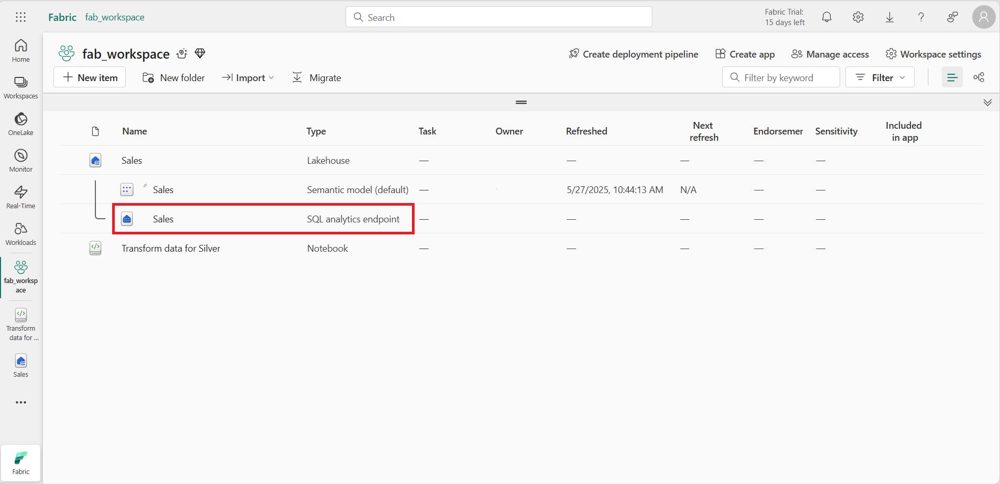
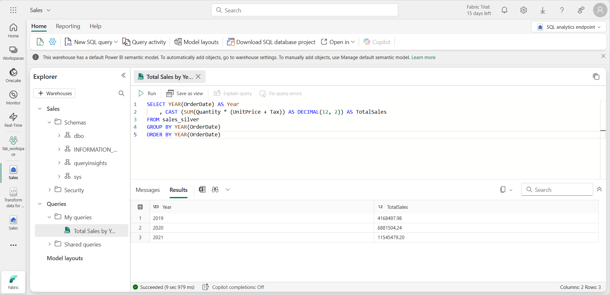
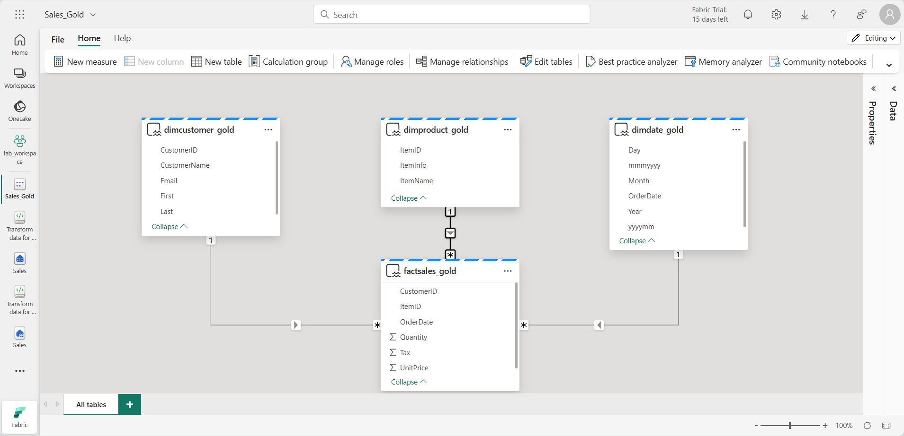

# Lab 4a: Create a medallion architecture in a Fabric lakehouse

In this lab you build a medallion architecture in your lakehouse using notebooks. You load raw data into the **bronze** layer, clean it and load it into a **silver** Delta table, then model it into a star schema of **gold** Delta tables (a date dimension, a customer dimension, a product dimension, and a sales fact table). The gold tables you create here are the business-ready data that the semantic model in Lab 6 builds on.

**Approximate time:** 45 minutes

> **Start here:** Open your **Macula-FabricDemo-Workshop** workspace and select your **MaculaWorkshopDemo** lakehouse. Your lakehouse needs **Lakehouse schemas** turned on, which you selected during setup.

## Upload data to the bronze layer

Bronze holds the data exactly as it arrived, with no changes.

1. In the **Explorer** pane, open the **...** menu for the **Files** folder, select **New subfolder**, and create a folder named `bronze`.
1. Open the **...** menu for the **bronze** folder, select **Upload** > **Upload files**, and upload the three sales files from this repo: `Labs/Lab4a/Assets/orders/2019.csv`, `2020.csv`, and `2021.csv`. Hold the Shift key to select all three at once.
1. Select the **bronze** folder and verify that the three files were uploaded.

    

## Transform data and load to a silver Delta table

Now you use a notebook to clean the bronze data and load it into a Delta table in the silver layer.

1. While viewing the **bronze** folder, open the **Open notebook** menu on the **Home** tab and select **New notebook**. A new notebook with a single *cell* opens. Notebooks are made of cells that contain *code* or *markdown* (formatted text).
1. Rename the notebook to `Transform data for Silver` by selecting the **Notebook xxxx** text at the top left and entering the new name.

    

1. Select the existing cell, which contains some commented-out code, and delete those two lines. You do not need them.

    > **Note:** Notebooks can run code in several languages, including Python, Scala, and SQL. In this lab you use PySpark and SQL. You can also add markdown cells to document your code.

1. Paste this code into the cell:

    ```python
    from pyspark.sql.types import *

    # Create the schema for the table
    orderSchema = StructType([
        StructField("SalesOrderNumber", StringType()),
        StructField("SalesOrderLineNumber", IntegerType()),
        StructField("OrderDate", DateType()),
        StructField("CustomerName", StringType()),
        StructField("Email", StringType()),
        StructField("Item", StringType()),
        StructField("Quantity", IntegerType()),
        StructField("UnitPrice", FloatType()),
        StructField("Tax", FloatType())
        ])

    # Import all files from bronze folder of lakehouse
    df = spark.read.format("csv").option("header", "false").schema(orderSchema).load("Files/bronze/*.csv")

    # Display the first 10 rows of the dataframe to preview your data
    display(df.head(10))
    ```

1. Select the **&#9655; Run cell** button on the left of the cell.

    > **Note:** This is the first Spark code you run in this notebook, so a Spark session has to start. The first run can take a minute or so. Later runs are quicker.

1. When the cell completes, review the output below it. It should look similar to this:

    | Index | SalesOrderNumber | SalesOrderLineNumber | OrderDate | CustomerName | Email | Item | Quantity | UnitPrice | Tax |
    | -- | -- | -- | -- | -- | -- | -- | -- | -- | -- |
    | 1 | SO49172 | 1 | 2021-01-01 | Brian Howard | brian23@adventure-works.com | Road-250 Red, 52 | 1 | 2443.35 | 195.468 |
    | 2 | SO49173 | 1 | 2021-01-01 | Linda Alvarez | linda19@adventure-works.com | Mountain-200 Silver, 38 | 1 | 2071.4197 | 165.7136 |
    | ... | ... | ... | ... | ... | ... | ... | ... | ... | ... |

    The code loaded the CSV files from the **bronze** folder into a Spark DataFrame and displayed the first few rows.

    > **Note:** Use the **...** menu at the top left of the output pane to clear, hide, or auto-resize the cell output.

1. Next you add columns for data validation and cleanup. Select **+ Code** to add a new code cell, then add this code:

    ```python
    from pyspark.sql.functions import when, lit, col, current_timestamp, input_file_name

    # Add columns IsFlagged, CreatedTS and ModifiedTS
    df = df.withColumn("FileName", input_file_name()) \
        .withColumn("IsFlagged", when(col("OrderDate") < '2019-08-01',True).otherwise(False)) \
        .withColumn("CreatedTS", current_timestamp()).withColumn("ModifiedTS", current_timestamp())

    # Update CustomerName to "Unknown" if CustomerName null or empty
    df = df.withColumn("CustomerName", when((col("CustomerName").isNull() | (col("CustomerName")=="")),lit("Unknown")).otherwise(col("CustomerName")))
    ```

    The first line imports the PySpark functions you need. You then add columns that track the source file name, whether the order falls before the fiscal year of interest, and when the row was created and modified. Finally, you set CustomerName to "Unknown" when it is null or empty.

1. Select **&#9655; Run cell** to run it.
1. Now you define the schema of the **sales_silver** table in Delta Lake format. Add a new code cell and enter this code:

    ```python
    # Define the schema for the sales_silver table

    from pyspark.sql.types import *
    from delta.tables import *

    DeltaTable.createIfNotExists(spark) \
        .tableName("dbo.sales_silver") \
        .addColumn("SalesOrderNumber", StringType()) \
        .addColumn("SalesOrderLineNumber", IntegerType()) \
        .addColumn("OrderDate", DateType()) \
        .addColumn("CustomerName", StringType()) \
        .addColumn("Email", StringType()) \
        .addColumn("Item", StringType()) \
        .addColumn("Quantity", IntegerType()) \
        .addColumn("UnitPrice", FloatType()) \
        .addColumn("Tax", FloatType()) \
        .addColumn("FileName", StringType()) \
        .addColumn("IsFlagged", BooleanType()) \
        .addColumn("CreatedTS", DateType()) \
        .addColumn("ModifiedTS", DateType()) \
        .execute()
    ```

1. Select **&#9655; Run cell** to run it.
1. In the **Explorer** pane, open the **...** menu for **Tables** and select **Refresh**. The new **sales_silver** table is listed. The **&#9650;** (triangle) icon shows that it is a Delta table.

    > **Note:** If you do not see the table, wait a few seconds and refresh again, or refresh the whole browser tab.

1. Now you run an *upsert* on the Delta table. It updates existing records that match your conditions and inserts new records when there is no match. Add a new code cell and paste this code:

    ```python
    # Update existing records and insert new ones based on a condition defined by the columns SalesOrderNumber, OrderDate, CustomerName, and Item.

    from delta.tables import *

    deltaTable = DeltaTable.forPath(spark, 'Tables/dbo/sales_silver')

    dfUpdates = df

    deltaTable.alias('silver') \
      .merge(
        dfUpdates.alias('updates'),
        'silver.SalesOrderNumber = updates.SalesOrderNumber and silver.OrderDate = updates.OrderDate and silver.CustomerName = updates.CustomerName and silver.Item = updates.Item'
      ) \
       .whenMatchedUpdate(set =
        {

        }
      ) \
     .whenNotMatchedInsert(values =
        {
          "SalesOrderNumber": "updates.SalesOrderNumber",
          "SalesOrderLineNumber": "updates.SalesOrderLineNumber",
          "OrderDate": "updates.OrderDate",
          "CustomerName": "updates.CustomerName",
          "Email": "updates.Email",
          "Item": "updates.Item",
          "Quantity": "updates.Quantity",
          "UnitPrice": "updates.UnitPrice",
          "Tax": "updates.Tax",
          "FileName": "updates.FileName",
          "IsFlagged": "updates.IsFlagged",
          "CreatedTS": "updates.CreatedTS",
          "ModifiedTS": "updates.ModifiedTS"
        }
      ) \
      .execute()
    ```

1. Select **&#9655; Run cell** to run it.

    This pattern matters when you load data from a source system that sends both updates to existing records and new records. Your silver Delta table now holds data that is ready for further transformation and modeling.

1. After the last cell finishes, select the **Run** tab above the ribbon and select **Stop session** to release the compute used by the notebook.

## Explore the silver layer with the SQL analytics endpoint

You can explore silver data with SQL through the SQL analytics endpoint. This is useful if you know SQL and want to do some quick analysis. You can also use tools such as SQL Server Management Studio (SSMS) or Azure Data Studio.

1. Go back to your lakehouse. At the top right of the page, switch from **Lakehouse** to **SQL analytics endpoint**.

    

1. Select **New SQL query** on the ribbon to open the query editor.
1. Paste this query and select **Run**:

    ```sql
    SELECT YEAR(OrderDate) AS Year
        , CAST (SUM(Quantity * (UnitPrice + Tax)) AS DECIMAL(12, 2)) AS TotalSales
    FROM dbo.sales_silver
    GROUP BY YEAR(OrderDate)
    ORDER BY YEAR(OrderDate)
    ```

    This calculates total sales for each year in the sales_silver table. The results look like this:

    

1. Next, check which customers buy the most (by quantity). Paste this query and select **Run**:

    ```sql
    SELECT TOP (10) CustomerName, SUM(Quantity) AS TotalQuantity
    FROM dbo.sales_silver
    GROUP BY CustomerName
    ORDER BY TotalQuantity DESC
    ```

    This returns the top 10 customers by quantity purchased.

    > **Note:** The SQL analytics endpoint uses T-SQL. If you adapt queries from other SQL dialects, use `TOP (10)` instead of `LIMIT 10`.

Exploring the silver layer is good for basic analysis. For more advanced analysis and reporting, you model the data into a star schema in the next section.

## Transform data for the gold layer

You have taken data from bronze, cleaned it, and loaded it into a silver Delta table. Now you use a new notebook to model that data into a star schema and load it into gold Delta tables.

You could do all of this in a single notebook. This lab uses separate notebooks to show the bronze to silver and silver to gold steps as distinct stages, which helps with debugging, troubleshooting, and reuse.

1. Switch back to the **Lakehouse** view, then create a new notebook named `Transform data for Gold` (**+ New item** in your workspace, then **Notebook**, then rename it).
1. In the **Explorer** pane, select **Add data items** > **From OneLake catalog**, select your **MaculaWorkshopDemo** lakehouse, and select **Connect**. The **sales_silver** table is listed under **Tables**.
1. In the existing code cell, remove the commented text, add this code to load the silver data into a DataFrame, and run it:

    ```python
    # Load data to the dataframe as a starting point to create the gold layer
    df = spark.read.table("dbo.sales_silver")
    ```

    > **Note:** If you get a `[TooManyRequestsForCapacity]` error when you run the first cell, make sure you stopped the session in the first notebook.

### Create the date dimension

1. Add a new code cell, paste this code to create the date dimension table, and run it:

    ```python
    from pyspark.sql.types import *
    from delta.tables import*

    # Define the schema for the dimdate_gold table
    DeltaTable.createIfNotExists(spark) \
        .tableName("dbo.dimdate_gold") \
        .addColumn("OrderDate", DateType()) \
        .addColumn("Day", IntegerType()) \
        .addColumn("Month", IntegerType()) \
        .addColumn("Year", IntegerType()) \
        .addColumn("mmmyyyy", StringType()) \
        .addColumn("yyyymm", StringType()) \
        .execute()
    ```

    > **Note:** You can run `display(df)` at any time to check your progress. For example, run `display(dfdimDate_gold)` to see the contents of the date dimension DataFrame.

1. In a new code cell, add and run this code to create a DataFrame for the date dimension:

    ```python
    from pyspark.sql.functions import col, dayofmonth, month, year, date_format

    # Create dataframe for dimDate_gold

    dfdimDate_gold = df.dropDuplicates(["OrderDate"]).select(col("OrderDate"), \
            dayofmonth("OrderDate").alias("Day"), \
            month("OrderDate").alias("Month"), \
            year("OrderDate").alias("Year"), \
            date_format(col("OrderDate"), "MMM-yyyy").alias("mmmyyyy"), \
            date_format(col("OrderDate"), "yyyyMM").alias("yyyymm"), \
        ).orderBy("OrderDate")

    # Display the first 10 rows of the dataframe to preview your data

    display(dfdimDate_gold.head(10))
    ```

1. The code is split into separate cells so you can watch what happens at each step. In another new code cell, add and run this code to update the date dimension as new data comes in:

    ```python
    from delta.tables import *

    deltaTable = DeltaTable.forPath(spark, 'Tables/dbo/dimdate_gold')

    dfUpdates = dfdimDate_gold

    deltaTable.alias('gold') \
      .merge(
        dfUpdates.alias('updates'),
        'gold.OrderDate = updates.OrderDate'
      ) \
       .whenMatchedUpdate(set =
        {

        }
      ) \
     .whenNotMatchedInsert(values =
        {
          "OrderDate": "updates.OrderDate",
          "Day": "updates.Day",
          "Month": "updates.Month",
          "Year": "updates.Year",
          "mmmyyyy": "updates.mmmyyyy",
          "yyyymm": "updates.yyyymm"
        }
      ) \
      .execute()
    ```

The date dimension is ready.

### Create the customer dimension

1. Add a new code cell, paste this code to create the customer dimension table, and run it:

    ```python
    from pyspark.sql.types import *
    from delta.tables import *

    # Create customer_gold dimension delta table
    DeltaTable.createIfNotExists(spark) \
        .tableName("dbo.dimcustomer_gold") \
        .addColumn("CustomerName", StringType()) \
        .addColumn("Email",  StringType()) \
        .addColumn("First", StringType()) \
        .addColumn("Last", StringType()) \
        .addColumn("CustomerID", LongType()) \
        .execute()
    ```

1. In a new code cell, add and run this code to drop duplicate customers, select specific columns, and split `CustomerName` into `First` and `Last` name columns:

    ```python
    from pyspark.sql.functions import col, split

    # Create customer_silver dataframe

    dfdimCustomer_silver = df.dropDuplicates(["CustomerName","Email"]).select(col("CustomerName"),col("Email")) \
        .withColumn("First",split(col("CustomerName"), " ").getItem(0)) \
        .withColumn("Last",split(col("CustomerName"), " ").getItem(1))

    # Display the first 10 rows of the dataframe to preview your data

    display(dfdimCustomer_silver.head(10))
    ```

    This creates a new DataFrame, `dfdimCustomer_silver`, with duplicates removed and structured customer data, including separate `First` and `Last` name columns.

1. Next you create the ID column for customers. In a new code cell, paste and run:

    ```python
    from pyspark.sql.functions import monotonically_increasing_id, col, when, coalesce, max, lit

    dfdimCustomer_temp = spark.read.table("dbo.dimcustomer_gold")

    MAXCustomerID = dfdimCustomer_temp.select(coalesce(max(col("CustomerID")),lit(0)).alias("MAXCustomerID")).first()[0]

    dfdimCustomer_gold = dfdimCustomer_silver.join(dfdimCustomer_temp,(dfdimCustomer_silver.CustomerName == dfdimCustomer_temp.CustomerName) & (dfdimCustomer_silver.Email == dfdimCustomer_temp.Email), "left_anti")

    dfdimCustomer_gold = dfdimCustomer_gold.withColumn("CustomerID",monotonically_increasing_id() + MAXCustomerID + 1)

    # Display the first 10 rows of the dataframe to preview your data

    display(dfdimCustomer_gold.head(10))
    ```

    This uses a left anti join to leave out customers that already exist in the `dimcustomer_gold` table, then generates unique `CustomerID` values with `monotonically_increasing_id()`.

1. To keep the customer table up to date as new data arrives, paste and run this in a new code cell:

    ```python
    from delta.tables import *

    deltaTable = DeltaTable.forPath(spark, 'Tables/dbo/dimcustomer_gold')

    dfUpdates = dfdimCustomer_gold

    deltaTable.alias('gold') \
      .merge(
        dfUpdates.alias('updates'),
        'gold.CustomerName = updates.CustomerName AND gold.Email = updates.Email'
      ) \
       .whenMatchedUpdate(set =
        {

        }
      ) \
     .whenNotMatchedInsert(values =
        {
          "CustomerName": "updates.CustomerName",
          "Email": "updates.Email",
          "First": "updates.First",
          "Last": "updates.Last",
          "CustomerID": "updates.CustomerID"
        }
      ) \
      .execute()
    ```

### Create the product dimension

1. You repeat the same steps for products. In a new code cell, paste and run:

    ```python
    from pyspark.sql.types import *
    from delta.tables import *

    DeltaTable.createIfNotExists(spark) \
        .tableName("dbo.dimproduct_gold") \
        .addColumn("ItemName", StringType()) \
        .addColumn("ItemID", LongType()) \
        .addColumn("ItemInfo", StringType()) \
        .execute()
    ```

1. Add another code cell to create the **product_silver** DataFrame:

    ```python
    from pyspark.sql.functions import col, split, lit, when

    # Create product_silver dataframe

    dfdimProduct_silver = df.dropDuplicates(["Item"]).select(col("Item")) \
        .withColumn("ItemName",split(col("Item"), ", ").getItem(0)) \
        .withColumn("ItemInfo",when((split(col("Item"), ", ").getItem(1).isNull() | (split(col("Item"), ", ").getItem(1)=="")),lit("")).otherwise(split(col("Item"), ", ").getItem(1)))

    # Display the first 10 rows of the dataframe to preview your data

    display(dfdimProduct_silver.head(10))
    ```

1. Now create the IDs for the **dimproduct_gold** table. Add this code to a new cell and run it:

    ```python
    from pyspark.sql.functions import monotonically_increasing_id, col, lit, max, coalesce

    #dfdimProduct_temp = dfdimProduct_silver
    dfdimProduct_temp = spark.read.table("dbo.dimproduct_gold")

    MAXProductID = dfdimProduct_temp.select(coalesce(max(col("ItemID")),lit(0)).alias("MAXItemID")).first()[0]

    dfdimProduct_gold = dfdimProduct_silver.join(dfdimProduct_temp,(dfdimProduct_silver.ItemName == dfdimProduct_temp.ItemName) & (dfdimProduct_silver.ItemInfo == dfdimProduct_temp.ItemInfo), "left_anti")

    dfdimProduct_gold = dfdimProduct_gold.withColumn("ItemID",monotonically_increasing_id() + MAXProductID + 1)

    # Display the first 10 rows of the dataframe to preview your data

    display(dfdimProduct_gold.head(10))
    ```

    This works out the next available product ID from the current table, assigns IDs to the new products, and displays the result.

1. As with the other dimensions, keep the product table up to date. In a new code cell, paste and run:

    ```python
    from delta.tables import *

    deltaTable = DeltaTable.forPath(spark, 'Tables/dbo/dimproduct_gold')

    dfUpdates = dfdimProduct_gold

    deltaTable.alias('gold') \
      .merge(
            dfUpdates.alias('updates'),
            'gold.ItemName = updates.ItemName AND gold.ItemInfo = updates.ItemInfo'
            ) \
            .whenMatchedUpdate(set =
            {

            }
            ) \
            .whenNotMatchedInsert(values =
             {
              "ItemName": "updates.ItemName",
              "ItemInfo": "updates.ItemInfo",
              "ItemID": "updates.ItemID"
              }
              ) \
              .execute()
    ```

With the dimensions built, the last step is the fact table.

### Create the fact table

1. In a new code cell, paste and run this code to create the **fact table**:

    ```python
    from pyspark.sql.types import *
    from delta.tables import *

    DeltaTable.createIfNotExists(spark) \
        .tableName("dbo.factsales_gold") \
        .addColumn("CustomerID", LongType()) \
        .addColumn("ItemID", LongType()) \
        .addColumn("OrderDate", DateType()) \
        .addColumn("Quantity", IntegerType()) \
        .addColumn("UnitPrice", FloatType()) \
        .addColumn("Tax", FloatType()) \
        .execute()
    ```

1. In a new code cell, paste and run this code to create a DataFrame that combines the sales data with customer and product information (customer ID, item ID, order date, quantity, unit price, and tax):

    ```python
    from pyspark.sql.functions import col

    dfdimCustomer_temp = spark.read.table("dbo.dimcustomer_gold")
    dfdimProduct_temp = spark.read.table("dbo.dimproduct_gold")

    df = df.withColumn("ItemName",split(col("Item"), ", ").getItem(0)) \
        .withColumn("ItemInfo",when((split(col("Item"), ", ").getItem(1).isNull() | (split(col("Item"), ", ").getItem(1)=="")),lit("")).otherwise(split(col("Item"), ", ").getItem(1))) \


    # Create Sales_gold dataframe

    dffactSales_gold = df.alias("df1").join(dfdimCustomer_temp.alias("df2"),(df.CustomerName == dfdimCustomer_temp.CustomerName) & (df.Email == dfdimCustomer_temp.Email), "left") \
            .join(dfdimProduct_temp.alias("df3"),(df.ItemName == dfdimProduct_temp.ItemName) & (df.ItemInfo == dfdimProduct_temp.ItemInfo), "left") \
        .select(col("df2.CustomerID") \
            , col("df3.ItemID") \
            , col("df1.OrderDate") \
            , col("df1.Quantity") \
            , col("df1.UnitPrice") \
            , col("df1.Tax") \
        ).orderBy(col("df1.OrderDate"), col("df2.CustomerID"), col("df3.ItemID"))

    # Display the first 10 rows of the dataframe to preview your data

    display(dffactSales_gold.head(10))
    ```

1. To keep the sales data up to date, run this in a new code cell:

    ```python
    from delta.tables import *

    deltaTable = DeltaTable.forPath(spark, 'Tables/dbo/factsales_gold')

    dfUpdates = dffactSales_gold

    deltaTable.alias('gold') \
      .merge(
        dfUpdates.alias('updates'),
        'gold.OrderDate = updates.OrderDate AND gold.CustomerID = updates.CustomerID AND gold.ItemID = updates.ItemID'
      ) \
       .whenMatchedUpdate(set =
        {

        }
      ) \
     .whenNotMatchedInsert(values =
        {
          "CustomerID": "updates.CustomerID",
          "ItemID": "updates.ItemID",
          "OrderDate": "updates.OrderDate",
          "Quantity": "updates.Quantity",
          "UnitPrice": "updates.UnitPrice",
          "Tax": "updates.Tax"
        }
      ) \
      .execute()
    ```

    This uses the Delta Lake merge operation to synchronize the `factsales_gold` table with the new sales data. It compares the order date, customer ID, and item ID between the existing table and the updates, updating matching records and inserting new ones.

1. In the **Explorer** pane, refresh **Tables** and confirm that these four gold tables exist: `dimdate_gold`, `dimcustomer_gold`, `dimproduct_gold`, and `factsales_gold`.
1. Select the **Run** tab and select **Stop session**.

You now have a curated, modeled **gold** layer that you can use for reporting and analysis.

## (Optional) Create a semantic model

You can use the gold layer to create a report. First you create a semantic model that defines relationships and measures.

> **Note:** This optional task needs a paid capacity with Power BI capabilities, or a separate Power BI Pro or Premium Per User license.

1. In your workspace, open your **MaculaWorkshopDemo** lakehouse.
1. Select **New semantic model** on the ribbon of the Explorer view.
1. Name the model `Sales_Gold`.
1. Select your gold tables and select **Confirm**:
    - dimdate_gold
    - dimcustomer_gold
    - dimproduct_gold
    - factsales_gold

The semantic model opens in Fabric, where you can create relationships and measures.



From here, your data team can build reports and dashboards directly on the gold layer of your lakehouse, so they always reflect the latest data.

## What you learned

You moved data through the bronze, silver, and gold layers of a medallion architecture using PySpark and Delta Lake. You cleaned the raw data, upserted it into a silver table, and modeled it into a star schema with a fact table and three dimensions. Each step uses a merge, so you can rerun the notebooks as new data arrives without creating duplicates.

**Previous:** [Lab 5: Use Delta tables in Apache Spark](../Lab5/03-delta-lake.md)

**Next:** [Lab 6: Design a semantic model for scale](../Lab6/15-design-semantic-model-scale.md)
