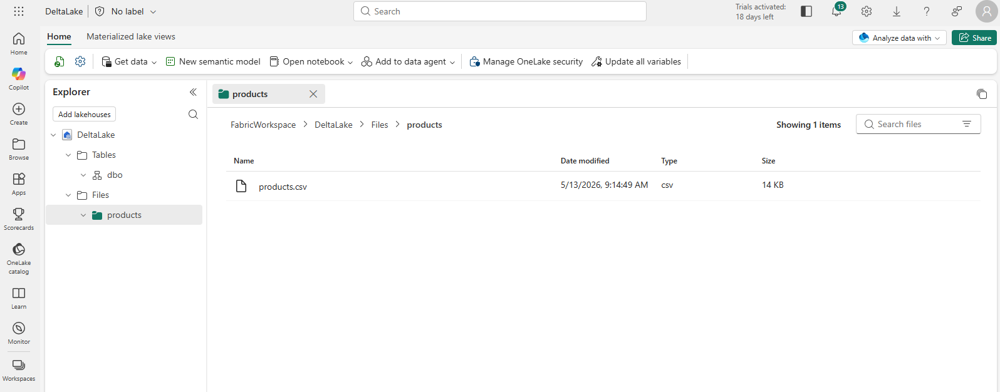
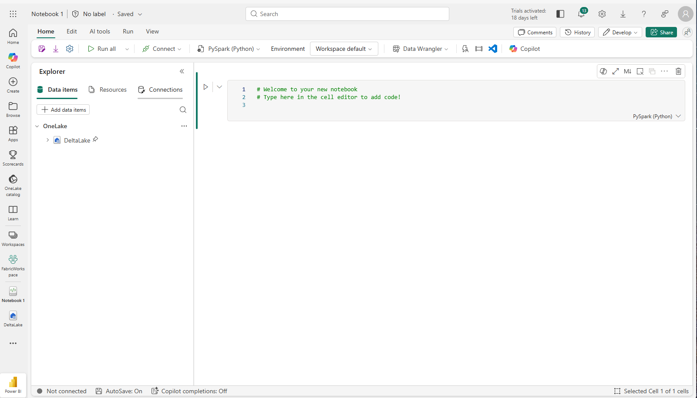
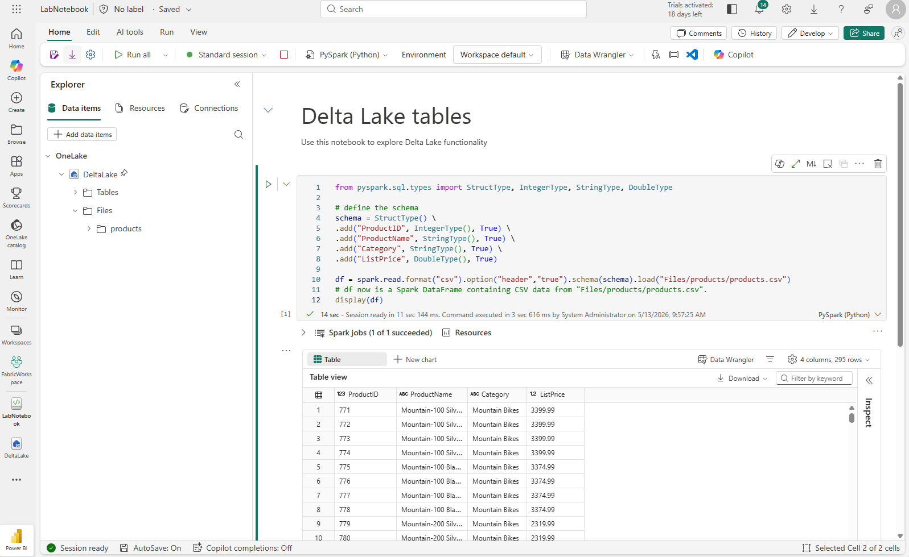
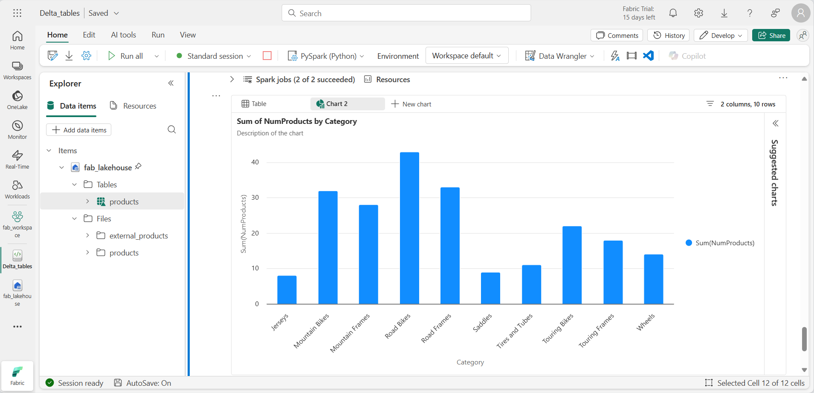

# Lab 5: Use Delta tables in Apache Spark

Tables in a Fabric lakehouse are based on the open-source Delta Lake format, which adds relational features such as transactions and versioning to both batch and streaming data. In this lab you create a managed Delta table with PySpark, explore table versioning (time travel), analyze the table with SQL, and use a Delta table as a sink for streaming data.

**Approximate time:** 45 minutes

> **Start here:** Open your **Macula-FabricDemo-Workshop** workspace and select your **MaculaWorkshopDemo** lakehouse.

## Upload the data file

1. In the **Explorer** pane, open the **...** menu next to the **Files** folder, select **New subfolder**, and create a subfolder named `products`. Use all lowercase letters.
1. Open the **...** menu for the **products** folder, select **Upload** > **Upload files**, and upload **products.csv** from this repo (`Labs/Lab5/Assets/products.csv`).
1. Select the **products** folder and verify that the file was uploaded.

    

## Explore data in a DataFrame

1. In the lakehouse, select **Open notebook** > **New notebook**. A notebook named **Notebook 1** opens.

    

1. Select the name panel above the **Home** tab and rename the notebook to something descriptive, such as `Delta Lake Exploration`.
1. Select the first cell (a code cell) and use the **M↓** button in the top-right toolbar to convert it to a markdown cell.
1. Select the pencil button to edit the cell, and replace its contents with:

    ```markdown
    # Delta Lake tables
    Use this notebook to explore Delta Lake functionality
    ```

1. Select anywhere outside the cell to stop editing.
1. Add a new code cell with the following code, which reads the products data into a DataFrame using a defined schema:

    > **Tip:** To add a code cell, select **+ Code** (it appears when you hover above or below a cell). You can also use **Edit** > **+ Add code cell below** on the ribbon.

    ```python
    from pyspark.sql.types import StructType, IntegerType, StringType, DoubleType

    # define the schema
    schema = StructType() \
    .add("ProductID", IntegerType(), True) \
    .add("ProductName", StringType(), True) \
    .add("Category", StringType(), True) \
    .add("ListPrice", DoubleType(), True)

    df = spark.read.format("csv").option("header","true").schema(schema).load("Files/products/products.csv")
    # df now is a Spark DataFrame containing CSV data from "Files/products/products.csv".
    display(df)
    ```

    > **Tip:** Use the « chevron icon to hide or show the Explorer pane.

1. Select **&#9655; Run cell** to the left of the cell.

    > **Note:** This is the first code you run in this notebook, so a Spark session has to start. The first run can take a minute or so.

1. Review the output below the cell.

    

## Create a Delta table

Now that the product data is in a DataFrame, you can save it as a Delta table. The quickest way is the `saveAsTable` method.

1. Add a new code cell, enter this code, and run it:

    ```python
    df.write.format("delta").saveAsTable("dbo.products_table")
    ```

1. In the **Explorer** pane, **Refresh** the **Tables** folder, expand **Tables**, and verify that **products_table** was created.

    > **Note:** The triangle icon next to the table name indicates a Delta table.

## Explore table versioning

Delta Lake records every change to a table in a transaction log. You can use the log to view the history of changes and query earlier versions of the data. This is called *time travel*.

To see it in action, you update some data and then look at what Delta Lake recorded.

1. Add a new code cell and run this code to reduce the list price of mountain bikes by 10%:

    ```sql
    %%sql
    UPDATE dbo.products_table
    SET ListPrice = ListPrice * 0.9
    WHERE Category = 'Mountain Bikes';
    ```

1. Add another code cell and run this code to view the table's transaction history:

    ```sql
    %%sql
    DESCRIBE HISTORY dbo.products_table;
    ```

    The results show each transaction recorded for the table. Version 0 is the original write, and version 1 is the update you just ran.

1. Add another code cell and run this code to compare the original and updated prices for mountain bikes:

    ```sql
    %%sql
    SELECT
        o.ProductName,
        o.ListPrice AS OriginalPrice,
        u.ListPrice AS UpdatedPrice
    FROM dbo.products_table VERSION AS OF 0 o
    JOIN dbo.products_table u ON o.ProductID = u.ProductID
    WHERE o.Category = 'Mountain Bikes'
    ORDER BY o.ProductName;
    ```

    Each row shows a mountain bike with its original and updated price in separate columns.

## Analyze Delta table data with SQL queries

You can run analytical queries against Delta tables with SQL. A *temporary view* is a named query that lasts for your session. You reference it like a table, which keeps later queries shorter and easier to read.

1. Add a new code cell and run this code to create a temporary view that summarizes products by category:

    ```sql
    %%sql
    CREATE OR REPLACE TEMPORARY VIEW products_view
    AS
        SELECT Category, COUNT(*) AS NumProducts, MIN(ListPrice) AS MinPrice, MAX(ListPrice) AS MaxPrice, AVG(ListPrice) AS AvgPrice
        FROM products_table
        GROUP BY Category;

    SELECT *
    FROM products_view
    ORDER BY Category;
    ```

    > **Troubleshooting:** If you see `TABLE_OR_VIEW_NOT_FOUND` for `dbo.products_table`, the notebook is not attached to your lakehouse. In the **Explorer** pane, select **Add data items**, add **MaculaWorkshopDemo**, and run the cell again.

1. Add a new code cell and run this code to get the top 10 categories by number of products. You query the view directly, without repeating the aggregation:

    ```sql
    %%sql
    SELECT Category, NumProducts
    FROM products_view
    ORDER BY NumProducts DESC
    LIMIT 10;
    ```

1. When the data is returned, select **+ New chart** to display one of the suggested charts.

    

You can also query the view with PySpark, which is useful when you want to apply DataFrame operations or visualizations to your SQL results.

1. Add a new code cell and run this code:

    ```python
    from pyspark.sql.functions import col, desc

    df_products = spark.sql("SELECT Category, MinPrice, MaxPrice, AvgPrice FROM products_view").orderBy(col("AvgPrice").desc())
    display(df_products.limit(6))
    ```

## Use Delta tables for streaming data

Delta Lake supports streaming data. A Delta table can be a sink or a source for data streams created with the Spark Structured Streaming API. In this example you use a Delta table as a sink for streaming data in a simulated Internet of Things (IoT) scenario.

1. Add a new code cell, add this code, and run it:

    ```python
    from notebookutils import mssparkutils
    from pyspark.sql.types import *
    from pyspark.sql.functions import *

    # Create a folder
    inputPath = 'Files/iot_data/'
    mssparkutils.fs.mkdirs(inputPath)

    # Create a stream that reads data from the folder, using a JSON schema
    jsonSchema = StructType([
    StructField("device", StringType(), False),
    StructField("status", StringType(), False)
    ])
    iotstream = spark.readStream.schema(jsonSchema).option("maxFilesPerTrigger", 1).json(inputPath)

    # Write some event data to the folder
    device_data = '''{"device":"Dev1","status":"ok"}
    {"device":"Dev1","status":"ok"}
    {"device":"Dev1","status":"ok"}
    {"device":"Dev2","status":"error"}
    {"device":"Dev1","status":"ok"}
    {"device":"Dev1","status":"error"}
    {"device":"Dev2","status":"ok"}
    {"device":"Dev2","status":"error"}
    {"device":"Dev1","status":"ok"}'''

    mssparkutils.fs.put(inputPath + "data.txt", device_data, True)

    print("Source stream created...")
    ```

    > **Note:** This lab uses a folder named `iot_data` so the stream does not pick up the `sales.csv` file you uploaded to `Files/data` in Lab 1.

    Make sure the message *Source stream created...* appears. The code created a streaming source based on a folder that contains data representing readings from hypothetical IoT devices.

1. In a new code cell, add and run this code:

    ```python
    # Write the stream to a delta table
    delta_stream_table_path = 'Tables/dbo/iotdevicedata'
    checkpointpath = 'Files/delta/checkpoint'
    deltastream = iotstream.writeStream.format("delta").option("checkpointLocation", checkpointpath).start(delta_stream_table_path)
    print("Streaming to delta sink...")
    ```

    This code writes the streaming device data in Delta format to a folder named iotdevicedata. Because the folder is in the **Tables** area, a table is created for it automatically.

1. In a new code cell, add and run this code:

    ```sql
    %%sql
    SELECT * FROM dbo.IotDeviceData;
    ```

    This queries the IotDeviceData table, which holds the device data from the streaming source.

1. In a new code cell, add and run this code:

    ```python
    # Add more data to the source stream
    more_data = '''{"device":"Dev1","status":"ok"}
    {"device":"Dev1","status":"ok"}
    {"device":"Dev1","status":"ok"}
    {"device":"Dev1","status":"ok"}
    {"device":"Dev1","status":"error"}
    {"device":"Dev2","status":"error"}
    {"device":"Dev1","status":"ok"}'''

    mssparkutils.fs.put(inputPath + "more-data.txt", more_data, True)
    ```

    This writes more hypothetical device data to the streaming source.

1. Run the cell that contains the following code again:

    ```sql
    %%sql
    SELECT * FROM dbo.IotDeviceData;
    ```

    The table should now include the additional data.

1. In a new code cell, add code to stop the stream and run it:

    ```python
    deltastream.stop()
    ```

## What you learned

Delta tables give you transactions, version history, and time travel on top of files in OneLake. The same table can be queried with PySpark and SQL, and can act as a sink for streaming data.

**Next:** [Lab 6: Design a semantic model for scale](../Lab6/15-design-semantic-model-scale.md)
