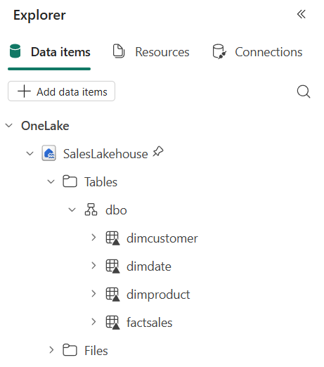
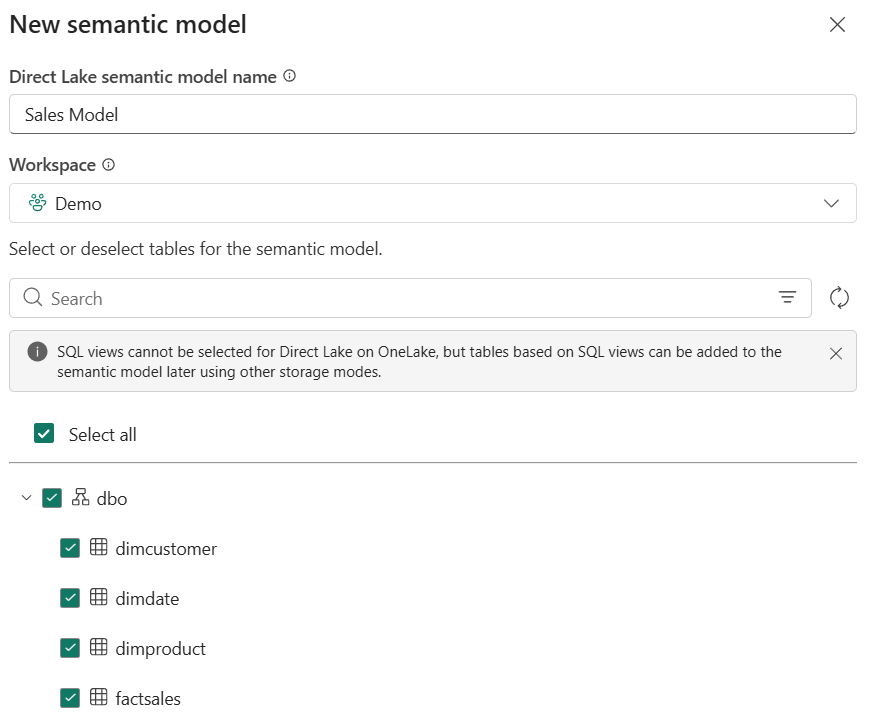
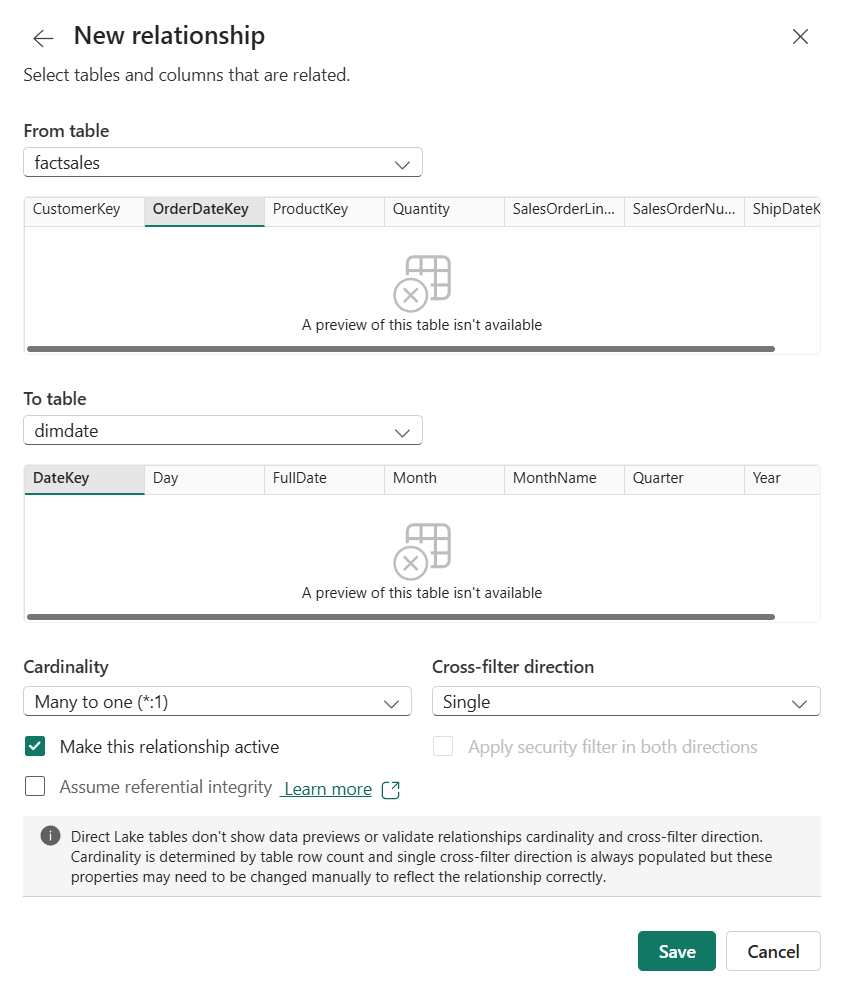
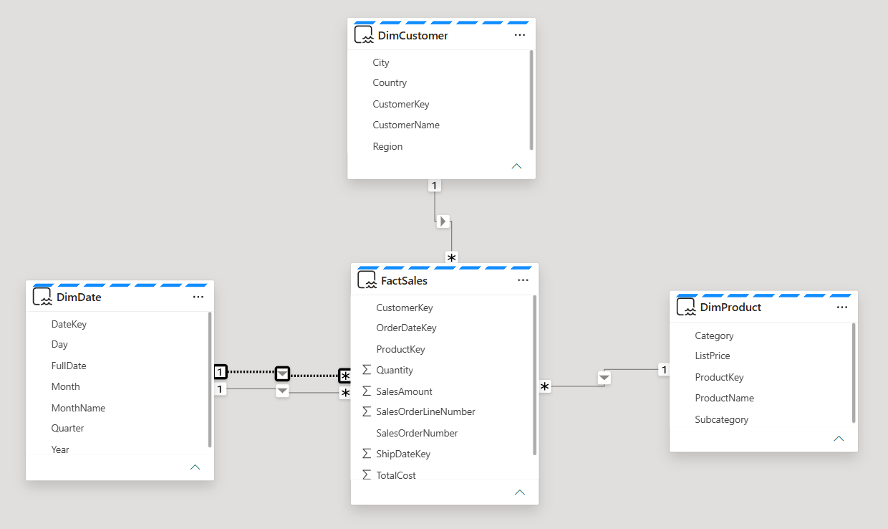
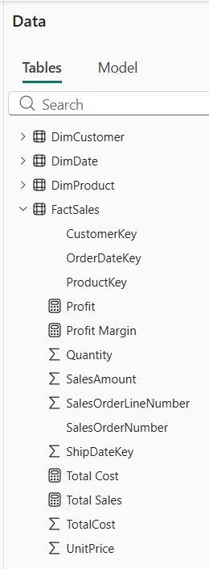
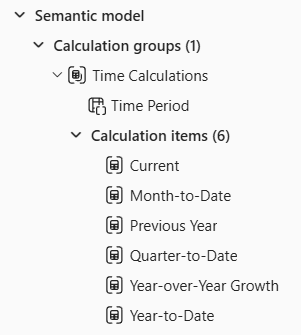
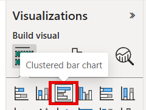
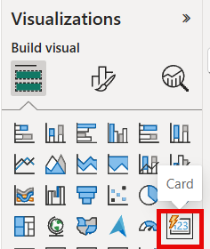
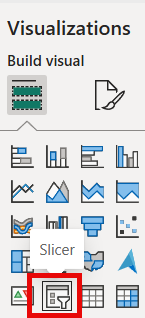
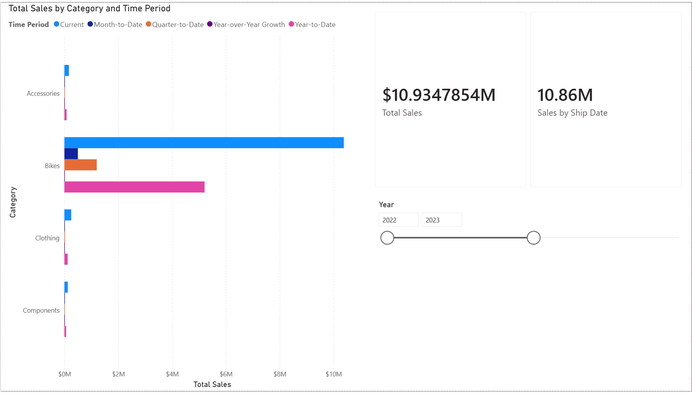

# Lab 6: Design a semantic model for scale

In this lab you design a semantic model for scale in the Fabric service. You connect to lakehouse data with Direct Lake, build star schema relationships, create a calculation group for time intelligence, and configure settings that support large datasets and many concurrent users. You learn how to:

- Create a semantic model that connects to lakehouse data through Direct Lake.
- Design star schema relationships with the right filter direction and referential integrity.
- Create a calculation group for time intelligence across several measures.
- Configure settings for scale, including query scale-out.

**Approximate time:** 30 minutes

> **Start here:** Open your **Macula-FabricDemo-Workshop** workspace. This lab needs Power BI capabilities on your capacity, which Trial, Premium, and Fabric capacities provide.

## Create the sample sales data

You need tables to model. You import a notebook that generates sample sales data and run it against your lakehouse.

1. In your workspace, select **Import** > **Notebook** and upload **Create-Sales-Data.ipynb** from this repo (`Labs/Lab6/Assets/Create-Sales-Data.ipynb`). The notebook appears in your workspace.
1. Open the **Create-Sales-Data** notebook.
1. In the **Explorer** pane, select **Add data items** > **OneLake catalog**, select your **MaculaWorkshopDemo** lakehouse, and select **Connect**.
1. The notebook has two code cells with comments explaining each block. The first cell creates three dimension tables (`DimDate`, `DimProduct`, `DimCustomer`). The second cell generates 5,000 fact table rows (`FactSales`).
1. Select **Run all** on the toolbar and wait for both cells to complete.
1. Use the lakehouse explorer on the left to verify that these tables appear under **Tables**:
    - `DimCustomer`
    - `DimDate`
    - `DimProduct`
    - `FactSales`

    > If the tables do not appear, select **Refresh** on the toolbar.

    

    > **Note:** There can be a short delay between the tables appearing in the explorer and being fully available to other Fabric items such as a new semantic model. Wait a minute or two after all four tables appear before you continue.

## Create a semantic model

The model you build uses Direct Lake to query data straight from lakehouse Delta tables without importing a copy. That removes the refresh bottlenecks and memory limits that constrain large datasets. You then add star schema relationships, explicit measures, calculation groups, and role-playing dimensions, which are the patterns that keep a model fast and maintainable as tables, measures, and users grow.

1. Open your **MaculaWorkshopDemo** lakehouse. In the **Lakehouse explorer** menu bar, select **New semantic model**.
1. Name the model `Sales Model` and select only these tables:
    - `DimCustomer`
    - `DimDate`
    - `DimProduct`
    - `FactSales`
1. Select **Confirm**. The model can take a minute to open in the web modeling experience.

    > The semantic model uses Direct Lake mode by default because it connects to lakehouse Delta tables. No data import or refresh schedule is needed.

    > **Note:** If you see an error saying the semantic model "cannot refresh...because one or multiple source tables either do not exist or access was denied", the lakehouse tables probably have not finished syncing. Wait a few minutes, delete the semantic model, and repeat this task.

    

### Design star schema relationships

A star schema gives the query engine a simple, predictable path from filters to facts. Single-direction relationships and assumed referential integrity allow INNER joins and reduce the work per query, which matters as row counts grow into the millions.

1. In the model diagram, arrange the tables so `FactSales` is in the center and the three dimension tables are around it.
1. If relationships were not detected automatically, create them manually. Select **Manage relationships** on the ribbon, then **New relationship**, and configure the first one like this:

    > **Note:** Direct Lake tables do not show data previews in the relationship dialog. Cardinality is based on table row count and a single cross-filter direction is always filled in, but you may need to check these settings yourself.

    - From table: `FactSales`
      - Select the `OrderDateKey` column
    - To table: `DimDate`
      - Select the `DateKey` column
    - Cardinality: **Many to one (*:1)**
    - Cross-filter direction: **Single**
    - Select **Make this relationship active**
    - Select **Assume referential integrity**
    - Select **Save**

    > Assuming referential integrity tells the engine to use INNER joins instead of LEFT OUTER joins. This improves query performance when every foreign key has a matching dimension key.

    

1. Create a second relationship:

    - From table: `FactSales`
      - Select the `CustomerKey` column
    - To table: `DimCustomer`
      - Select the `CustomerKey` column
    - Cardinality: **Many to one (*:1)**
    - Cross-filter direction: **Single**
    - Select **Make this relationship active**
    - Select **Assume referential integrity**
    - Select **Save**

1. Create a third relationship:

    - From table: `FactSales`
      - Select the `ProductKey` column
    - To table: `DimProduct`
      - Select the `ProductKey` column
    - Cardinality: **Many to one (*:1)**
    - Cross-filter direction: **Single**
    - Select **Make this relationship active**
    - Select **Assume referential integrity**
    - Select **Save**

    > Single-direction filtering gives predictable filter propagation in a star schema.

1. Create a fourth relationship for the ship date:

    - From table: `FactSales`
      - Select the `ShipDateKey` column
    - To table: `DimDate`
      - Select the `DateKey` column
    - Cardinality: **Many to one (*:1)**
    - Cross-filter direction: **Single**
    - Clear **Make this relationship active**, because only one active relationship can exist between two tables at a time
    - Select **Assume referential integrity**
    - Select **Save**

The model diagram now shows a star schema with `FactSales` in the center and the dimension tables filtering inward through single-direction relationships.

> The blue dotted line at the top of each table shows that it uses Direct Lake storage mode.



### Create measures

Calculation groups need explicit DAX measures to work on. The `FactSales` table already has columns such as `SalesAmount` and `TotalCost` with row-level values. Power BI can auto-aggregate those in visuals as *implicit measures*, but implicit measures are disabled once you create a calculation group, so you define *explicit* measures first.

1. In the **Data** pane, right-click the `FactSales` table and select **New measure**.

    > **Tip:** You can copy all the DAX in this lab from the markdown cells of the **Create-Sales-Data** notebook you imported.

1. In the formula bar, enter this and press **Enter**:

    ```dax
    Total Sales = SUM(FactSales[SalesAmount])
    ```

1. Create a second measure on `FactSales`:

    ```dax
    Total Cost = SUM(FactSales[TotalCost])
    ```

1. Create a third measure:

    ```dax
    Profit =
    VAR TotalRevenue = [Total Sales]
    VAR TotalExpense = [Total Cost]
    RETURN
        TotalRevenue - TotalExpense
    ```

1. Create a fourth measure:

    ```dax
    Profit Margin =
    VAR ProfitAmount = [Profit]
    VAR TotalRevenue = [Total Sales]
    RETURN
        DIVIDE(ProfitAmount, TotalRevenue)
    ```

    > These measures use variables to hold intermediate results. Variables make the DAX easier to read and stop the engine from evaluating the same expression more than once.

You now have four new measures in `FactSales`, shown with calculator icons.



### Create a calculation group

A calculation group for time intelligence applies across all four base measures without creating separate measures for every combination. Instead of building YTD, QTD, and prior-year versions of every base measure, you define each pattern once. This keeps the model metadata small and maintenance low as you scale to dozens or hundreds of base measures.

1. In the model view, select **Calculation group** on the ribbon.

    > Choose **Yes** if you are asked to confirm that implicit measures will be discouraged in the model.

1. Rename the calculation group table to `Time Calculations` and rename the column to `Time Period`.
1. In the **Data** pane, select the calculation item that was created automatically and replace its formula with:

    ```dax
    Current = SELECTEDMEASURE()
    ```

1. Right-click the **Calculation items** field and select **New calculation item**. Create these items one at a time:

    ```dax
    Year-to-Date =
    CALCULATE(
        SELECTEDMEASURE(),
        DATESYTD('DimDate'[FullDate])
    )
    ```

    ```dax
    Quarter-to-Date =
    CALCULATE(
        SELECTEDMEASURE(),
        DATESQTD('DimDate'[FullDate])
    )
    ```

    ```dax
    Month-to-Date =
    CALCULATE(
        SELECTEDMEASURE(),
        DATESMTD('DimDate'[FullDate])
    )
    ```

    ```dax
    Previous Year =
    CALCULATE(
        SELECTEDMEASURE(),
        PREVIOUSYEAR('DimDate'[FullDate])
    )
    ```

1. Create one more calculation item for year-over-year growth:

    ```dax
    Year-over-Year Growth =
    VAR MeasurePriorYear =
        CALCULATE(
            SELECTEDMEASURE(),
            SAMEPERIODLASTYEAR('DimDate'[FullDate])
        )
    RETURN
        DIVIDE(
            (SELECTEDMEASURE() - MeasurePriorYear),
            MeasurePriorYear
        )
    ```

1. Select the `Year-over-Year Growth` item and turn on **Dynamic format string** in the **Properties** pane. Set the format string to `"0.##%"`.

    > The dynamic format string makes `Year-over-Year Growth` display as a percentage instead of a raw decimal, whichever base measure it applies to.

1. Verify that the calculation group has six items: `Current`, `Year-to-Date`, `Quarter-to-Date`, `Month-to-Date`, `Previous Year`, and `Year-over-Year Growth`.

> These six items apply to all four base measures automatically. Without the calculation group you would need 24 separate measures (4 base measures x 6 time patterns). With 50 or 100 base measures, the pattern prevents measure proliferation.



### Use USERELATIONSHIP for the inactive ship date relationship

Role-playing dimensions let you analyze data by different date columns (order date, ship date) without duplicating the Date table. Avoiding duplicate tables keeps the model small and the relationships simple, and both help at scale.

1. In the **Data** pane, right-click the `FactSales` table and select **New measure**.
1. Enter this formula and press **Enter**:

    ```dax
    Sales by Ship Date =
    CALCULATE(
        [Total Sales],
        USERELATIONSHIP(FactSales[ShipDateKey], DimDate[DateKey])
    )
    ```

    > `USERELATIONSHIP` temporarily activates the inactive relationship between `FactSales.ShipDateKey` and `DimDate.DateKey`.

### Configure settings for scale

These settings will not change what you see in the report you build next. They are what separate a lab prototype from a production-ready model.

1. Go back to your workspace and find **Sales Model** in the item list. Open its **...** menu and select **Settings**.
1. Expand **Query scale-out** and turn **Query scale-out** on.

    > With query scale-out, Fabric can create read-only replicas of your model so many users running reports at the same time do not compete for the same resources. This matters when dashboards are shared across large teams. Direct Lake models already use the large semantic model storage format, which scale-out requires, so the setting is ready to use.

    > If this setting is not available on your capacity, continue to the next section.

## Validate the model with a report

You build a report to check that the relationships, measures, and calculation group work.

1. Go back to your workspace, open the **...** menu next to **Sales Model**, and select **Create report**.
1. In the report canvas, create a **Clustered bar chart** and add these fields:

    - `DimProduct` > `Category` on the Y-axis
    - `Total Sales` on the X-axis

    

1. Verify that sales appear by product category. This confirms the relationships between the dimension and fact tables work.
1. With the bar chart selected, add the `Time Period` column from the `Time Calculations` table to the **Legend**. The chart now shows grouped bars for each time intelligence calculation, which confirms the calculation group works.
1. Create a **Card** visual and add both the `Total Sales` and `Sales by Ship Date` measures so you can see them side by side.

    

1. Create a **Slicer** visual and add `DimDate` > `Year`. The slicer defaults to a Between slider.

    

1. Move the slider to different year ranges (for example **2022-2023** or **2023-2024**) and watch how `Total Sales` and `Sales by Ship Date` change in the card.

> The two values differ because `Total Sales` uses the active relationship on `OrderDateKey`, while `Sales by Ship Date` uses `USERELATIONSHIP` to activate the inactive relationship on `ShipDateKey`.
>
> Ship dates are 14 to 60 days after order dates, so orders near a year boundary can fall into different years depending on which date is used. When the slicer covers the full range (2022-2024), the values are closer because most rows are included whichever date key is filtered.



## Try it with Copilot (optional)

Copilot works best on well-structured semantic models. This optional section tests whether Copilot can answer questions accurately against the star schema you built. It needs a paid capacity with Copilot enabled (see the [README](../../README.md)).

1. In the report, select the **Copilot** button on the ribbon, if it is available.
1. Ask Copilot: `"What was the total sales for each product category last year?"`
1. Check whether Copilot returns an accurate answer. A single fact table, clear many-to-one relationships, and explicit DAX measures give Copilot a straightforward path to the answer. Models with ambiguous relationships or missing measures are harder for Copilot to interpret.

## What you learned

You built a Direct Lake semantic model with star schema relationships, explicit measures, a time intelligence calculation group, a role-playing date dimension, and scale settings.

**Next:** [Lab 7: Analyze data with Apache Spark and Copilot in Fabric notebooks](../Lab7/22b-copilot-fabric-notebooks.md)
