# Lab 7: Analyze data with Apache Spark and Copilot in Fabric notebooks

In this lab you use Copilot in Fabric notebooks to load, clean, transform, and save data in your lakehouse. You describe each task in plain language and Copilot generates the Apache Spark code. You then use Copilot to query and chart the result.

**Scenario:** Contoso Health, a multi-specialty hospital network, wants to expand its services in the EU and needs to analyze projected population data. The lab uses the [Eurostat](https://ec.europa.eu/eurostat/web/main/home) population projection dataset (EUROPOP2023, population on January 1 by age, sex, and type of projection, [proj_23np](https://ec.europa.eu/eurostat/databrowser/product/view/proj_23np?category=proj.proj_23n), last updated June 28, 2023).

By the end of the lab you will be able to:

- Use Copilot in Fabric notebooks to generate code from natural language prompts.
- Ingest, clean, and transform data with Spark and Copilot-assisted workflows.
- Split, filter, and convert data types to prepare a statistical dataset.
- Save the result as a lakehouse table for downstream analytics.
- Use Copilot to generate queries and visualizations.

**Approximate time:** 30 minutes

> **Requirement:** This lab needs a paid Fabric capacity with Copilot enabled. A Fabric trial capacity does not support Copilot. See the [README](../../README.md) for details.
>
> **Start here:** Open your **Macula-FabricDemo-Workshop** workspace.
>
> **Shortcut:** A notebook with every prompt from this lab is included at `Labs/Lab7/Assets/eurostat-notebook.ipynb`. You can import it to copy prompts, but the lab is designed for you to type them into Copilot yourself.

## Create a notebook

Notebooks combine code, visualizations, and narrative text in one document. That makes it easy to document your workflow, explain your reasoning, and share results.

1. On the menu bar on the left, select **Create**. On the *New* page, under *Data Engineering*, select **Notebook**. A notebook named **Notebook 1** opens.

    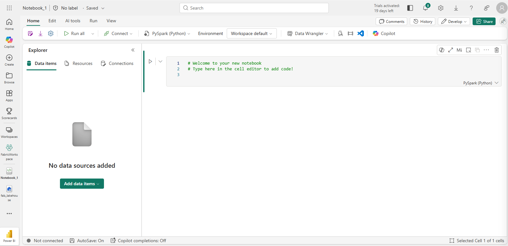

1. Select the name panel above the **Home** tab and rename the notebook, for example `Eurostat Population`.

    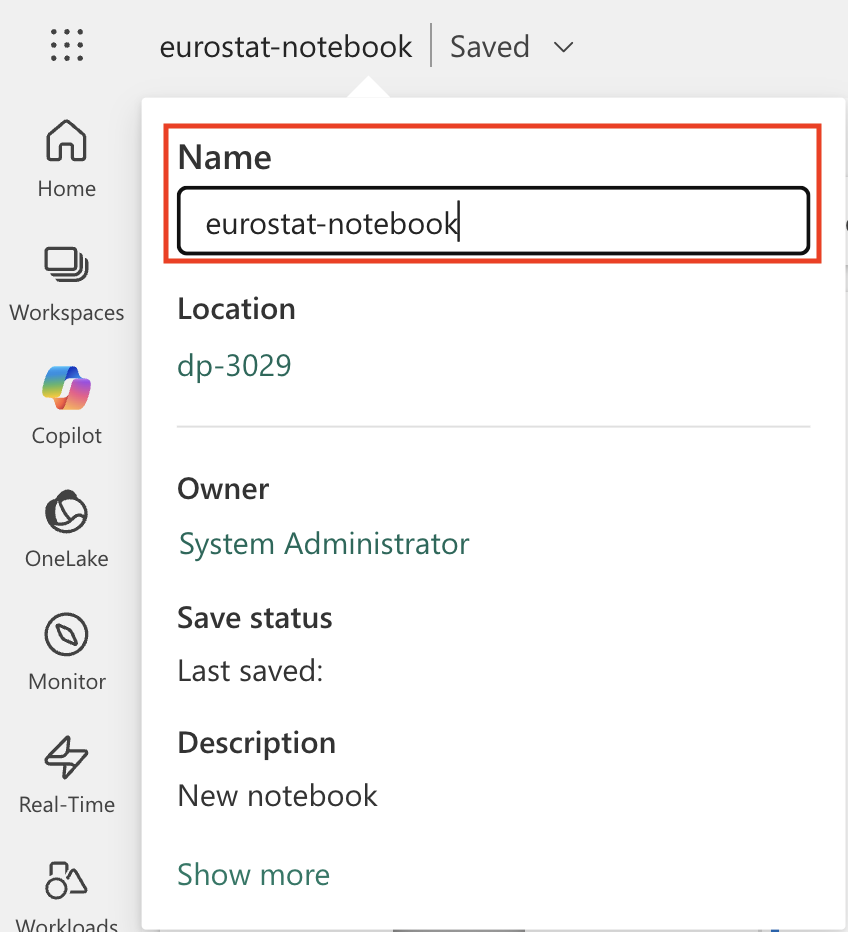

1. Select the first cell (a code cell) and use the **M↓** button in the top-right toolbar to convert it to a markdown cell.

    > **Why use markdown cells:** They document your analysis with formatted text, which makes the notebook easier to read later.

    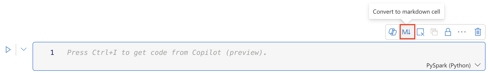

1. Select the pencil button to edit the cell, and replace its contents with:

    ```md
    # Explore Eurostat population data.
    Use this notebook to explore population data from Eurostat
    ```

    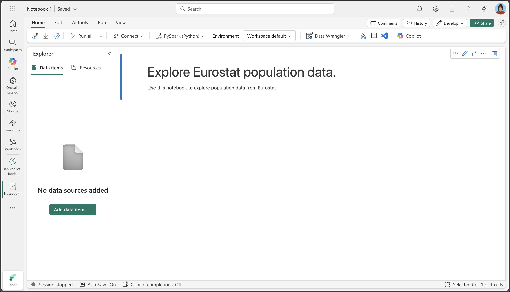

1. Select anywhere outside the cell to stop editing.

## Attach the lakehouse to your notebook

Attaching the lakehouse lets your notebook read from and write to it.

1. In the notebook's **Explorer** pane, select **Add data items**, then **From OneLake catalog**.

    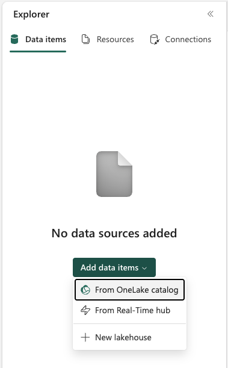

1. In the **OneLake catalog**, select your **MaculaWorkshopDemo** lakehouse and select **Connect**.
1. In the **Explorer** pane, expand the lakehouse and its **Files** list.

    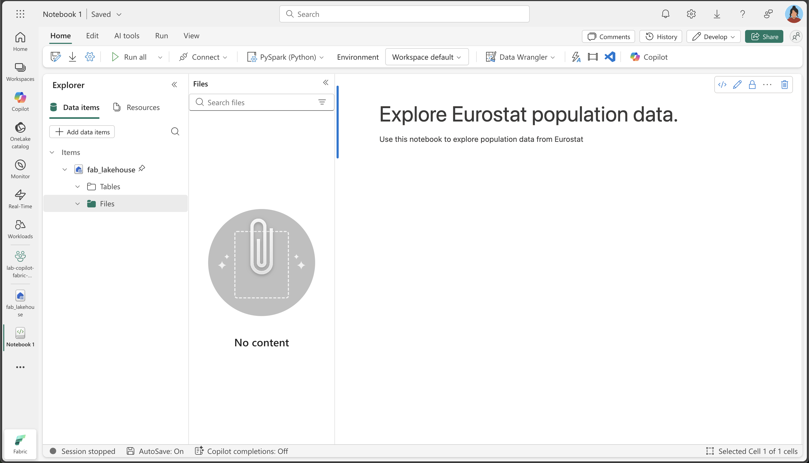

## Load data

Instead of writing Python from scratch, you describe what you want and Copilot generates the code.

1. On the **Home** ribbon, select **Copilot** to open the Copilot chat pane on the right.

    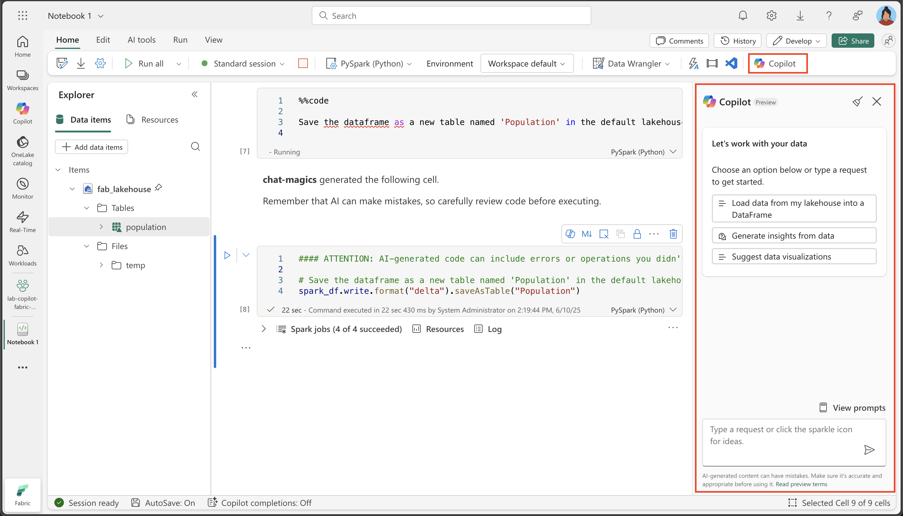

1. In the Copilot chat box, enter this prompt:

    ```copilot-prompt
    Download the following file from this URL:

    https://ec.europa.eu/eurostat/api/dissemination/sdmx/2.1/data/proj_23np$defaultview/?format=TSV

    Then write the file to the default lakehouse into a folder named temp. Create the folder if it doesn't exist yet.
    ```

1. Submit the prompt. When Copilot asks for permission to add a code cell, select **Allow**. Review the generated code before you run it. It might differ slightly from the code below.

    > Copilot turns your request into working Python. It understands that it needs to make an HTTP request, handle the file system, and save the file to a specific lakehouse location.

    Here is the full code in case you hit an exception:

    ```python
    #### ATTENTION: AI-generated code can include errors or operations you didn't intend. Review the code in this cell carefully before running it.

    import requests
    import os

    # Define the URL and the local path
    url = "https://ec.europa.eu/eurostat/api/dissemination/sdmx/2.1/data/proj_23np$defaultview/?format=TSV"
    local_path = "/lakehouse/default/Files/temp/"
    file_name = "proj_23np.tsv"
    file_path = os.path.join(local_path, file_name)

    # Create the temporary directory if it doesn't exist
    if not os.path.exists(local_path):
        os.makedirs(local_path)

    # Download the file
    response = requests.get(url)
    response.raise_for_status()  # Check that the request was successful

    # Write the content to the file
    with open(file_path, "wb") as file:
        file.write(response.content)

    print(f"File downloaded and saved to {file_path}")
    ```

1. If Copilot asks permission to run the new cell, select **Allow**. Otherwise, select **&#9655; Run cell**. After the cell runs successfully, select **Keep** in the Copilot pane. The file is saved to the **temp** folder in your lakehouse.

    > You might need to refresh your lakehouse **Files** with the **...** menu.

    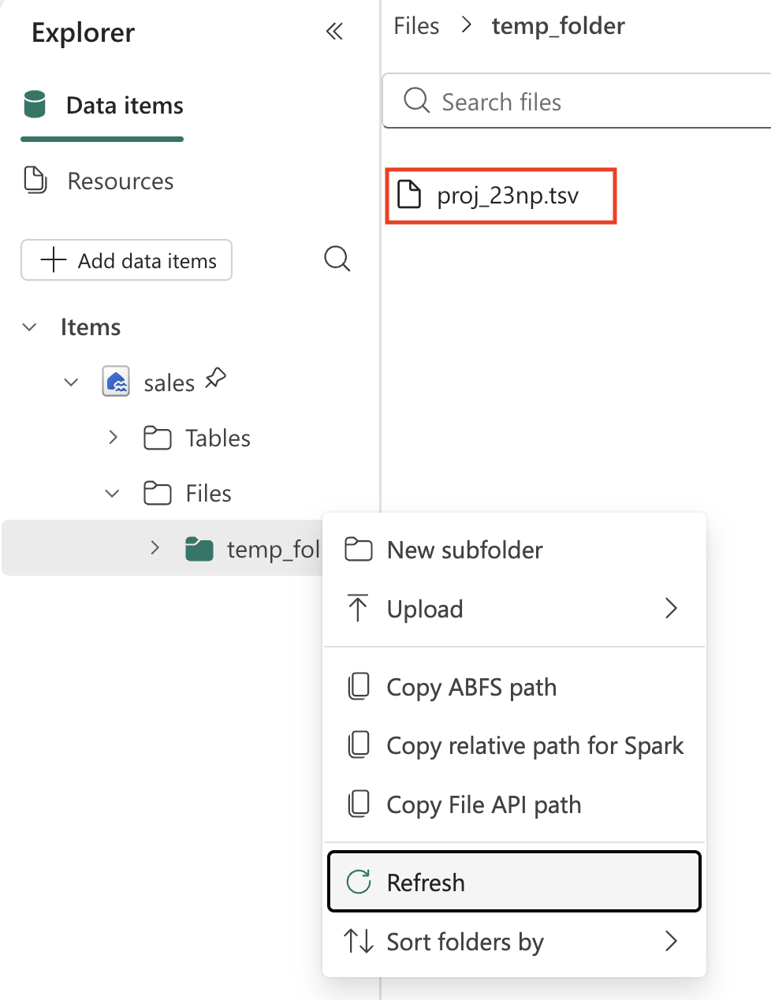

1. Now load the file into a Spark DataFrame so you can analyze and transform it.

    > **Information:** A DataFrame is a distributed collection of data organized into named columns, similar to a database table or a spreadsheet.

    In the Copilot chat box, enter:

    ```copilot-prompt
    Load the file 'Files/temp/proj_23np.tsv' into a spark dataframe.

    The fields are separated with a tab.

    Show the contents of the DataFrame using display method.
    ```

1. Submit the prompt and select **Allow** when Copilot asks to add a code cell. The generated code might differ from this example:

    ```python
    #### ATTENTION: AI-generated code can include errors or operations you didn't intend. Review the code in this cell carefully before running it.

    # Load the file 'Files/temp/proj_23np.tsv' into a spark dataframe.
    # The fields have been separated with a tab.
    file_path = "Files/temp/proj_23np.tsv"

    spark_df = spark.read.format("csv").option("delimiter", "\t").option("header", "true").load(file_path)

    # Show the contents of the DataFrame using display method
    display(spark_df)
    ```

1. If Copilot asks permission to run the new cell, select **Allow**. Otherwise, select **&#9655; Run cell**. After it runs successfully, select **Keep** in the Copilot pane.

An example of the output:

| freq,projection,sex,age,unit,geo\TIME_PERIOD |      2022  |      2023  |   ...  |      2100  |
| -------------------------------------------- | ---------- | ---------- | ------ | ---------- |
|                         A,BSL,F,TOTAL,PER,AT |   4553444  |   4619179  |   ...  |   4807661  |
|                         A,BSL,F,TOTAL,PER,BE |   5883978  |   5947528  |   ...  |   6331785  |
|                         A,BSL,F,TOTAL,PER,BG |   3527626  |   3605059  |   ...  |   2543673  |
|                                          ... |       ...  |       ...  |   ...  |   5081250  |
|                         A,BSL,F,TOTAL,PER,CY |    463622  |    476907  |   ...  |    504781  |

> **About the structure:** The first column holds several values separated by commas (frequency, projection type, sex, age, unit, and geographic location). The other columns are years with population values. This is common in statistical datasets and needs cleaning before analysis.

## Transform data: split fields

The first field combines six pieces of information. For analysis, each should be its own column. This is called normalizing the data.

1. In the Copilot chat box, enter:

    ```copilot-prompt
    From the currently loaded DataFrame, split the first field 'freq,projection,sex,age,unit,geo\TIME_PERIOD' using a comma into 6 separate fields. Then, remove the original column.
    ```

1. Submit the prompt and select **Allow** to add the cell. The generated code might differ from this example:

    ```python
    #### ATTENTION: AI-generated code can include errors or operations you didn't intend. Review the code in this cell carefully before running it.

    from pyspark.sql.functions import split, col

    # Split the first field 'freq,projection,sex,age,unit,geo\TIME_PERIOD' into 6 separate fields
    spark_df = spark_df.withColumn("freq", split(col("freq,projection,sex,age,unit,geo\\TIME_PERIOD"), ",").getItem(0)) \
                       .withColumn("projection", split(col("freq,projection,sex,age,unit,geo\\TIME_PERIOD"), ",").getItem(1)) \
                       .withColumn("sex", split(col("freq,projection,sex,age,unit,geo\\TIME_PERIOD"), ",").getItem(2)) \
                       .withColumn("age", split(col("freq,projection,sex,age,unit,geo\\TIME_PERIOD"), ",").getItem(3)) \
                       .withColumn("unit", split(col("freq,projection,sex,age,unit,geo\\TIME_PERIOD"), ",").getItem(4)) \
                       .withColumn("geo", split(col("freq,projection,sex,age,unit,geo\\TIME_PERIOD"), ",").getItem(5))

    # Show the updated DataFrame
    display(spark_df)
    ```

1. If Copilot asks permission to run the cell, select **Allow**. Otherwise, select **&#9655; Run cell**. After it runs, select **Keep**. Scroll the table to the right to see the new fields.

    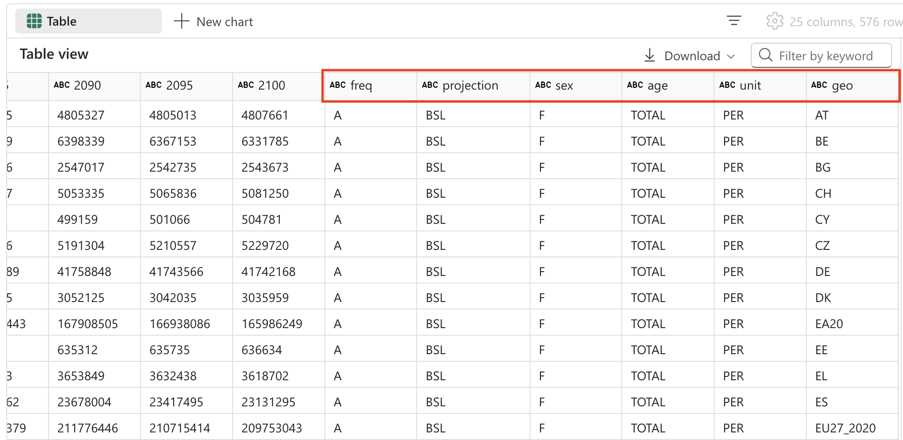

## Transform data: remove fields

Some fields have a single distinct value and add no analytical value. Removing them simplifies the dataset and improves performance. Here, `freq`, `age` (always TOTAL), and `unit` (always PER, persons) are constant.

1. In the Copilot chat box, enter:

    ```copilot-prompt
    From the currently loaded DataFrame, remove the fields 'freq', 'age', 'unit'.
    ```

1. Submit the prompt and select **Allow**. The generated code might differ from this example:

    ```python
    #### ATTENTION: AI-generated code can include errors or operations you didn't intend. Review the code in this cell carefully before running it.

    # Remove the fields 'freq', 'age', 'unit'
    spark_df = spark_df.drop("freq", "age", "unit")

    # Show the updated DataFrame
    display(spark_df)
    ```

1. Allow or run the cell, then select **Keep** in the Copilot pane.

## Transform data: reposition fields

It is common practice to put categorical columns (projection type, sex, location) before the numeric columns (population by year).

1. In the Copilot chat box, enter:

    ```copilot-prompt
    From the currently loaded DataFrame, the fields 'projection', 'sex', 'geo' should be positioned first.
    ```

1. Submit the prompt and select **Allow**. The generated code might differ from this example:

    ```python
    #### ATTENTION: AI-generated code can include errors or operations you didn't intend. Review the code in this cell carefully before running it.

    # Reorder the DataFrame with 'projection', 'sex', 'geo' fields first
    new_column_order = ['projection', 'sex', 'geo'] + [col for col in spark_df.columns if col not in {'projection', 'sex', 'geo'}]
    spark_df = spark_df.select(new_column_order)

    # Show the reordered DataFrame
    display(spark_df)
    ```

1. Allow or run the cell, then select **Keep** in the Copilot pane.

## Transform data: replace values

The projection field holds cryptic codes. You replace them with descriptive names. Statistical organizations model future population under different scenarios. The baseline is the most likely one, and the sensitivity tests show how population might change under different assumptions about fertility, mortality, and migration.

1. In the Copilot chat box, enter:

    ```copilot-prompt
    The 'projection' field contains codes that should be replaced with the following values:
        _'BSL' -> 'Baseline projections'.
        _'LFRT' -> 'Sensitivity test: lower fertility'.
        _'LMRT' -> 'Sensitivity test: lower mortality'.
        _'HMIGR' -> 'Sensitivity test: higher migration'.
        _'LMIGR' -> 'Sensitivity test: lower migration'.
        _'NMIGR' -> 'Sensitivity test: no migration'.
    ```

1. Submit the prompt and select **Allow**. The generated code might differ from this example:

    ```python
    #### ATTENTION: AI-generated code can include errors or operations you didn't intend. Review the code in this cell carefully before running it.

    from pyspark.sql.functions import when

    # Replace projection codes
    spark_df = spark_df.withColumn("projection",
                                   when(spark_df["projection"] == "BSL", "Baseline projections")
                                   .when(spark_df["projection"] == "LFRT", "Sensitivity test: lower fertility")
                                   .when(spark_df["projection"] == "LMRT", "Sensitivity test: lower mortality")
                                   .when(spark_df["projection"] == "HMIGR", "Sensitivity test: higher migration")
                                   .when(spark_df["projection"] == "LMIGR", "Sensitivity test: lower migration")
                                   .when(spark_df["projection"] == "NMIGR", "Sensitivity test: no migration")
                                   .otherwise(spark_df["projection"]))

    # Display the updated DataFrame
    display(spark_df)
    ```

1. Allow or run the cell, then select **Keep** in the Copilot pane.

    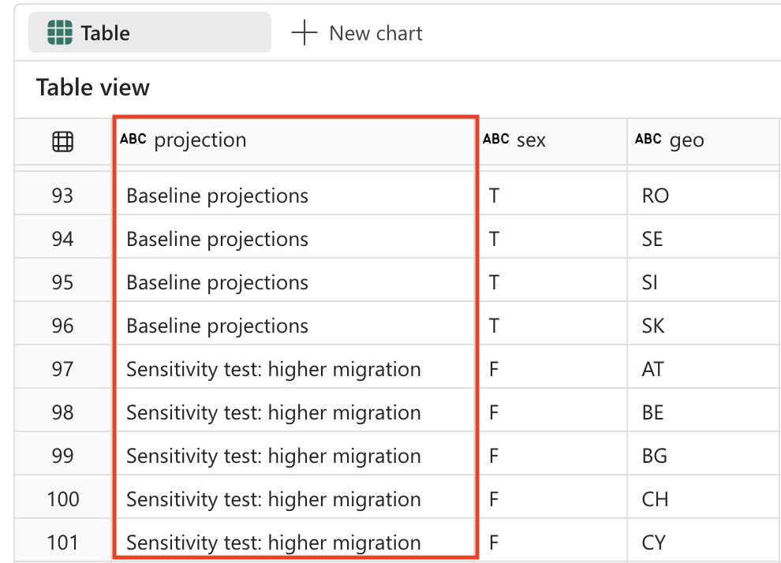

## Transform data: filter data

The table contains two rows for areas that are not countries: EU27_2020 (totals for the European Union, 27 countries) and EA20 (Euro area, 20 countries). You remove them to keep the data at the lowest grain. Aggregates can always be calculated later, but keeping them in the base data leads to double-counting.

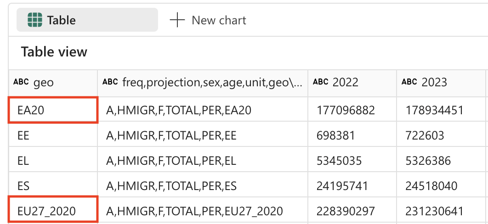

1. In the Copilot chat box, enter:

    ```copilot-prompt
    Filter the 'geo' field and remove values 'EA20' and 'EU27_2020' (these are not countries).
    ```

1. Submit the prompt and select **Allow**. The generated code might differ from this example:

    ```python
    #### ATTENTION: AI-generated code can include errors or operations you didn't intend. Review the code in this cell carefully before running it.

    # Filter out 'geo' values 'EA20' and 'EU27_2020'
    spark_df = spark_df.filter((spark_df['geo'] != 'EA20') & (spark_df['geo'] != 'EU27_2020'))

    # Display the filtered DataFrame
    display(spark_df)
    ```

1. Allow or run the cell, then select **Keep** in the Copilot pane.

The `sex` field has three distinct values:

- M: Male
- F: Female
- T: Total (male + female)

You remove the totals for the same reason. You can always add Male and Female to get a total, but you cannot split a total back into its parts.

1. In the Copilot chat box, enter:

    ```copilot-prompt
    Filter the 'sex' field and remove 'T' (these are totals).
    ```

1. Submit the prompt and select **Allow**. The generated code might differ from this example:

    ```python
    #### ATTENTION: AI-generated code can include errors or operations you didn't intend. Review the code in this cell carefully before running it.

    # Filter out 'sex' values 'T'
    spark_df = spark_df.filter(spark_df['sex'] != 'T')

    # Display the filtered DataFrame
    display(spark_df)
    ```

1. Allow or run the cell, then select **Keep** in the Copilot pane.

## Transform data: trim spaces

Some field names in the table have a trailing space. Extra spaces cause problems when you query data or build visualizations, and they are common in data from external sources.

1. In the Copilot chat box, enter:

    ```copilot-prompt
    Strip spaces from all field names in the dataframe.
    ```

1. Submit the prompt and select **Allow**. The generated code might differ from this example:

    ```python
    #### ATTENTION: AI-generated code can include errors or operations you didn't intend. Review the code in this cell carefully before running it.

    from pyspark.sql.functions import col

    # Strip spaces from all field names
    spark_df = spark_df.select([col(column).alias(column.strip()) for column in spark_df.columns])

    # Display the updated DataFrame
    display(spark_df)
    ```

1. Allow or run the cell, then select **Keep** in the Copilot pane.

## Transform data: data type conversion

Data loaded from text files starts out as strings. To analyze it later in Power BI or SQL, the year columns need to be integers so you can calculate and sort correctly.

1. In the Copilot chat box, enter:

    ```copilot-prompt
    Convert the data type of all the year fields to integer.
    ```

1. Submit the prompt and select **Allow**. The generated code might differ from this example:

    ```python
    #### ATTENTION: AI-generated code can include errors or operations you didn't intend. Review the code in this cell carefully before running it.

    from pyspark.sql.functions import col

    # Convert the data type of all the year fields to integer
    year_columns = [col(column).cast("int") for column in spark_df.columns if column.strip().isdigit()]
    spark_df = spark_df.select(*spark_df.columns[:3], *year_columns)

    # Display the updated DataFrame
    display(spark_df)
    ```

1. Allow or run the cell, then select **Keep** in the Copilot pane. An example of the output, with columns and rows removed for brevity:

| projection           | sex | geo | 2022    | 2023    | ...     | 2100    |
| -------------------- | --- | --- | ------- | ------- | ------- | ------- |
| Baseline projections | F   | AT  | 4553444 | 4619179 | ...     | 4807661 |
| Baseline projections | F   | BE  | 5883978 | 5947528 | ...     | 6331785 |
| Baseline projections | F   | BG  | 3527626 | 3605059 | ...     | 2543673 |
| ...                  | ... | ... | ...     | ...     | ...     | ...     |
| Baseline projections | F   | LU  | 320333  | 329401  | ...     | 498954  |

> **Tip:** You might need to scroll the table to the right to see all columns.

## Save data

Saving the cleaned data as a lakehouse table lets you and others reuse it without repeating the transformations. It also makes the data available to other Fabric tools such as Power BI, the SQL analytics endpoint, and Data Factory.

1. In the Copilot chat box, enter:

    ```copilot-prompt
    Save the dataframe as a new table named 'Population' in the default lakehouse.
    ```

1. Submit the prompt and select **Allow**. The generated code might differ from this example:

    ```python
    #### ATTENTION: AI-generated code can include errors or operations you didn't intend. Review the code in this cell carefully before running it.

    spark_df.write.format("delta").saveAsTable("Population")
    ```

1. Allow or run the cell, then select **Keep** in the Copilot pane.

## Validate with a question

Now you ask Copilot a question in natural language and let it write the query and the chart.

1. Expand **Tables** in your lakehouse and check the new table. You might need to refresh the **Tables** folder with the **...** menu.

    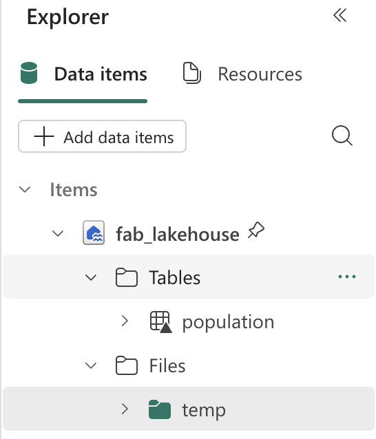

1. In the Copilot chat box, enter:

    ```copilot-prompt
    What are the projected population trends for geo BE  from 2020 to 2050 as a line chart visualization. Make sure to sum up male and female numbers. Use only existing columns from the population table. Perform the query using SQL.
    ```

    > This prompt shows Copilot using context (your Population table), generating SQL, and creating a visualization in a single request.

1. Submit the prompt and select **Allow**. The generated code might differ from this example:

    ```python
    #### ATTENTION: AI-generated code can include errors or operations you didn't intend. Review the code in this cell carefully before running it.

    import plotly.graph_objs as go

    # Perform the SQL query to get projected population trends for geo BE, summing up male and female numbers
    result = spark.sql(
        """
        SELECT projection, sex, geo, SUM(`2022`) as `2022`, SUM(`2023`) as `2023`, SUM(`2025`) as `2025`,
               SUM(`2030`) as `2030`, SUM(`2035`) as `2035`, SUM(`2040`) as `2040`,
               SUM(`2045`) as `2045`, SUM(`2050`) as `2050`
        FROM Population
        WHERE geo = 'BE' AND projection = 'Baseline projections'
        GROUP BY projection, sex, geo
        """
    )
    df = result.groupBy("projection").sum()
    df = df.orderBy("projection").toPandas()

    # Extract data for the line chart
    years = df.columns[1:].tolist()
    values = df.iloc[0, 1:].tolist()

    # Create the plot
    fig = go.Figure()
    fig.add_trace(go.Scatter(x=years, y=values, mode='lines+markers', name='Projected Population'))

    # Update the layout
    fig.update_layout(
        title='Projected Population Trends for Geo BE (Belgium) from 2022 to 2050',
        xaxis_title='Year',
        yaxis_title='Population',
        template='plotly_dark'
    )

    # Display the plot
    fig.show()
    ```

1. Allow or run the cell, then select **Keep** in the Copilot pane. Look at the chart it created:

    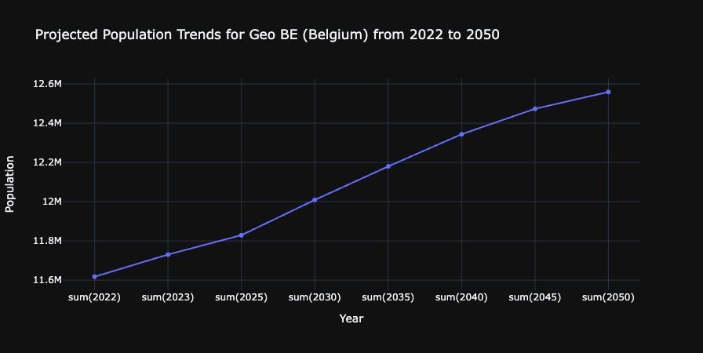

## What you learned

You used Copilot to take a raw statistical file through ingestion, cleaning, transformation, storage, and analysis, without writing the Spark code yourself. Always review AI-generated code before you run it.

**Next:** [Lab 8: Chat with your data using Fabric data agents](../Lab8/22d-copilot-fabric-data-agents.md)
