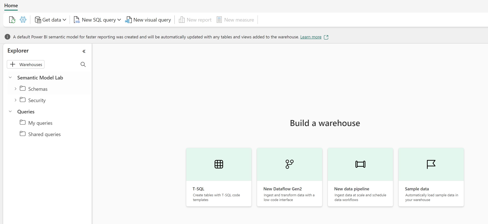
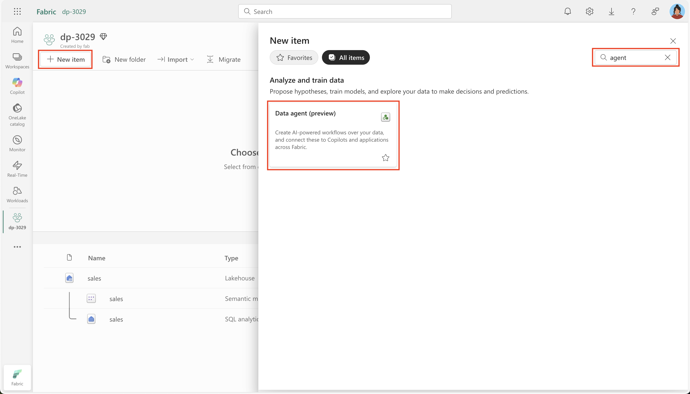
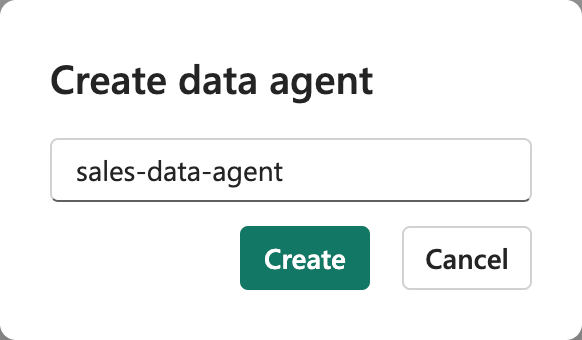
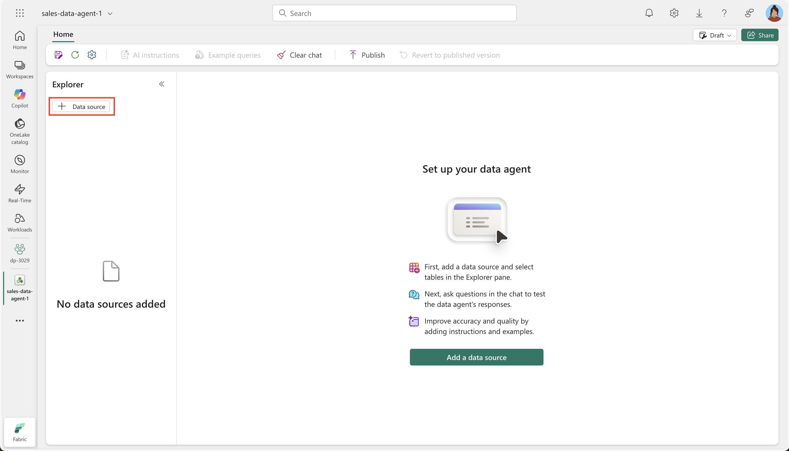
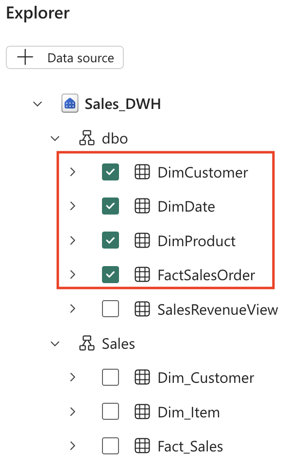
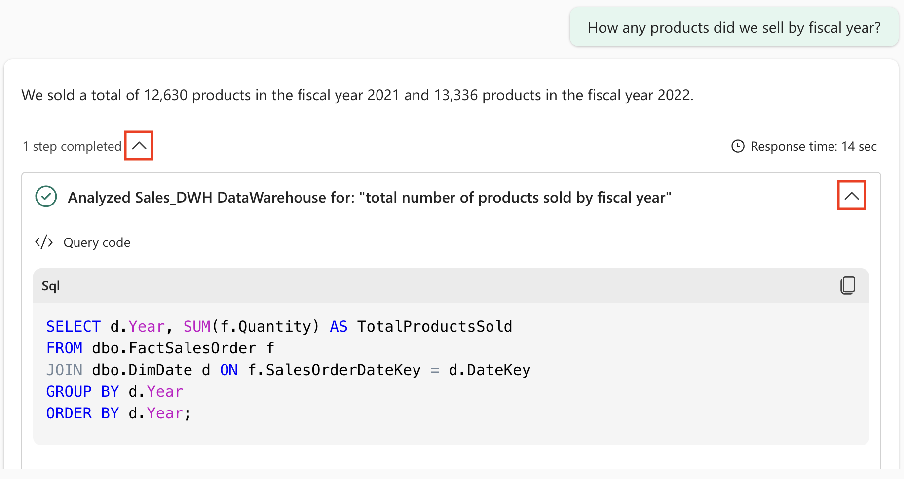

# Lab 8: Chat with your data using Fabric data agents

A Fabric data agent lets you ask questions about your data in plain English and get structured, readable answers. You do not need to know SQL, DAX, or KQL. In this lab you create a small sales data warehouse, build a data agent on top of it, and watch how the agent turns your questions into SQL.

By the end of the lab you will:

- Understand what Fabric data agents are for.
- Load a star schema sales dataset into a warehouse.
- See how a data agent translates plain English into SQL.
- Practice asking effective analytical questions and reading the results.

**Approximate time:** 30 minutes

> **Requirement:** This lab needs a paid Fabric capacity with Copilot and data agents enabled. A Fabric trial capacity does not support Copilot. See the [README](../../README.md) for details.
>
> **Start here:** Open your **Macula-FabricDemo-Workshop** workspace.

## Create a data warehouse

A data warehouse is a central store of structured data optimized for analytical queries. You create a simple sales warehouse to be the source for your data agent.

1. On the menu bar on the left, select **Create**. On the *New* page, under the *Data Warehouse* section, select **Warehouse**. Give it a unique name, for example `MaculaSalesWarehouse`.

    > **Note:** If **Create** is not pinned to the sidebar, select the ellipsis (**...**) first.

    After a minute or so, the new warehouse is created.

    

## Create tables and insert data

A warehouse is a relational database where you define tables and other objects. The script you run creates a typical star schema: dimension tables (descriptive attributes) and a fact table (measurable business events). This design suits the analytical queries the data agent generates.

1. On the **Home** menu tab, select **New SQL Query**.
1. Open `Labs/Lab8/Assets/create-dw.txt` from this repo, copy all of its Transact-SQL, and paste it into the new query pane.

    > The script creates a sales warehouse with customer information, product details, date dimensions, and sales transactions.

1. Run the query. It takes about 30 seconds.
1. Select **Refresh** on the toolbar. In the **Explorer** pane, verify that the **dbo** schema now contains these four tables:

    - **DimCustomer**: customer names, locations, and contact details
    - **DimDate**: fiscal years, quarters, and months for time-based analysis
    - **DimProduct**: product names, categories, and pricing
    - **FactSalesOrder**: the sales transactions that link customers, products, and dates

    > **Tip:** If the schema takes a while to load, refresh the browser page.

## Create a Fabric data agent

A data agent understands natural language questions about your data and generates the queries to answer them.

1. Create a new data agent.

    

1. Name it `sales-data-agent`.

    > A descriptive name helps you and your team understand the agent's purpose, especially when you manage several agents for different data domains.

    

1. Select **Add a data source**.

    

1. Choose the data warehouse you created.
1. Expand the warehouse and select **DimCustomer**, **DimDate**, **DimProduct**, and **FactSalesOrder**.

    > Selecting all four tables gives the agent the whole data model, so it can answer questions that span tables, such as sales by customer location or product performance over time.

    

## Ask questions

Each question shows you the answer and the SQL the agent generated for it.

1. Type this prompt:

    ```copilot-prompt
    How many products did we sell by fiscal year?
    ```

    The answer: 12,630 products sold in fiscal year 2021 and 13,336 in fiscal year 2022.

1. Expand the completed step and its substep to see the SQL the agent generated.

    > Reading the generated SQL shows you how the agent interpreted the question and builds trust in the results.

    

    The SQL might differ slightly depending on your environment and the latest Copilot updates:

    ```sql
    SELECT d.Year, SUM(f.Quantity) AS TotalProductsSold
    FROM dbo.FactSalesOrder f
    JOIN dbo.DimDate d ON f.SalesOrderDateKey = d.DateKey
    GROUP BY d.Year
    ORDER BY d.Year;
    ```

    > The query joins the fact table to the date dimension, groups by year, and sums the quantities. The agent worked out that "products sold" means the Quantity field and "fiscal year" maps to the Year field in the date dimension.

1. Ask the next question:

    ```copilot-prompt
    What are the top 10 most popular products all time?
    ```

    > This shows ranking: the agent joins product information with sales data to find the bestsellers.

1. Follow up with:

    ```copilot-prompt
    What are the historical trends across all my data?
    ```

    > This broader question shows trend analysis across several dimensions.

1. Try more questions to explore different parts of your data:

    ```copilot-prompt
    In which countries are our customers located?
    ```

    ```copilot-prompt
    How many products did we sell in the United States?
    ```

    ```copilot-prompt
    How much revenue did we make in FY 2022?
    ```

    ```copilot-prompt
    How much was our total sales revenue, by fiscal year, fiscal quarter and month name?
    ```

    > These cover geographic analysis, filtered aggregations, revenue calculations, and time hierarchies. Try variations to see how the agent handles different phrasings.

## Understand your data structure

Keep these facts about the data in mind to ask better questions:

- **Fiscal year timing:** The fiscal year starts in July. Q1 is July to September, Q2 is October to December, Q3 is January to March, and Q4 is April to June.
- **Customer identification:** The CustomerAltKey field holds customer email addresses, which is useful for customer-specific queries.
- **Currency:** All list prices and sales totals are in GBP (British pounds).
- **Data relationships:** The FactSalesOrder table connects customers, products, and dates through foreign keys, which allows multi-dimensional analysis.

Try questions that combine these facts, such as "What was our revenue in Q1 of FY 2022?" or "Which customers in the UK bought the most expensive products?"

## What you learned

- **Plain-English access to data:** People can get answers without knowing SQL.
- **Transparency:** You can always inspect the generated SQL to see how a question was answered.
- **Flexible phrasing:** The agent handles variations in wording and minor typos.
- **Complex queries:** The agent builds the joins, aggregations, and filters for you.

**Ideas to explore next:** Add custom instructions with business-specific context, connect more data sources, ask multi-period or segment questions, and embed agent answers in reports or applications.

**Back to the workshop:** [README](../../README.md)
